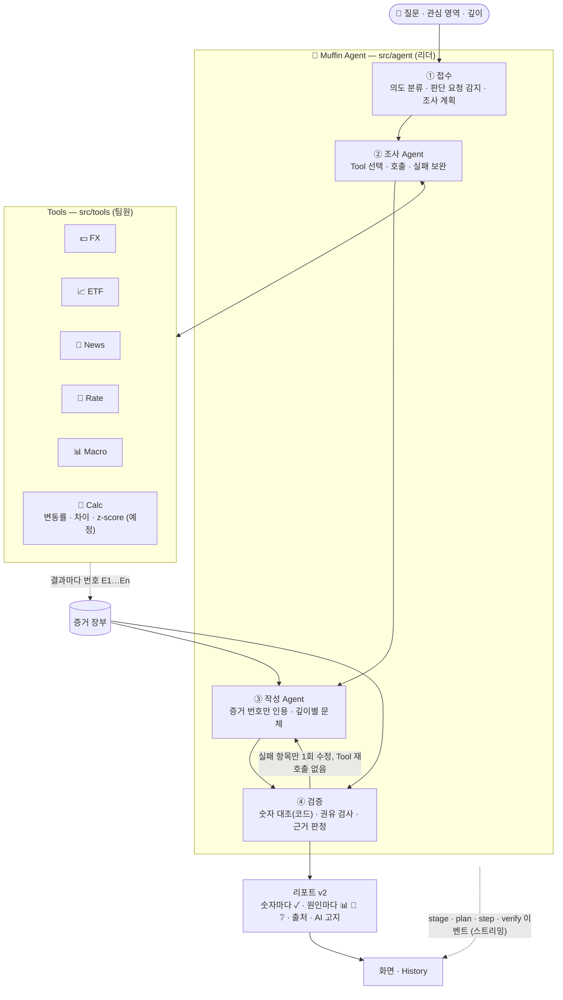
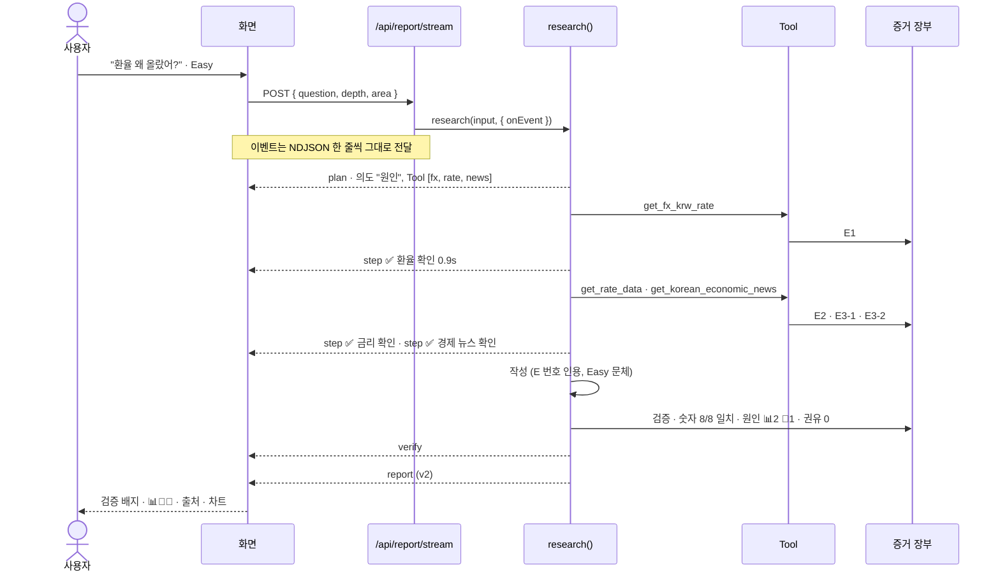
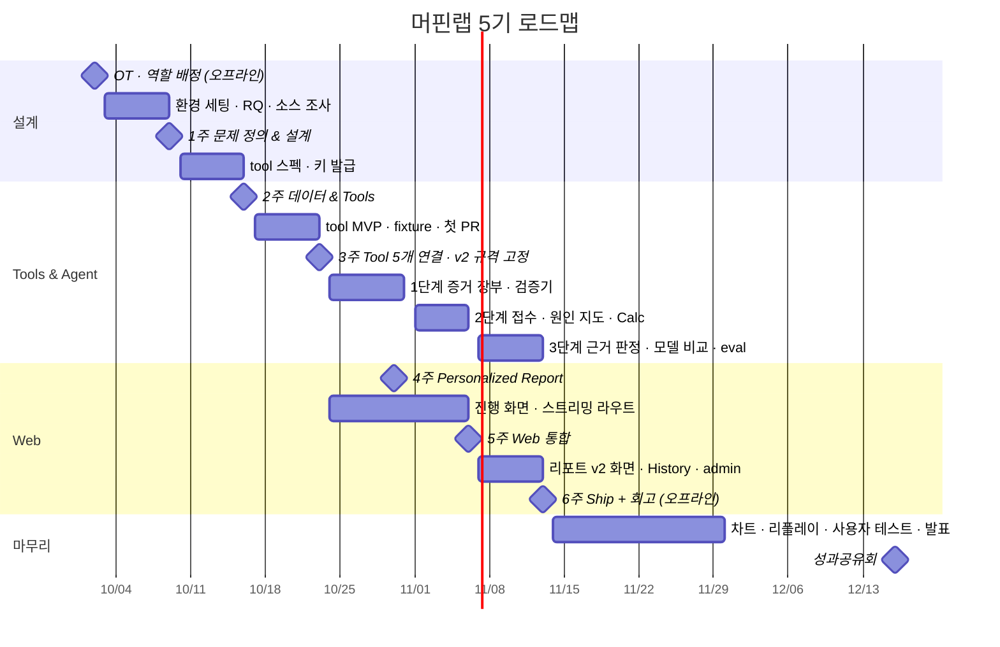

# 🧁 Muffin Lab — Money & Finance Intelligence Agent

환율 · ETF · 경제뉴스 · 금리 · 물가 중 궁금한 영역을 고르고 질문하면, Agent 가 필요한 Tool 을 골라 데이터를 조사하고 **출처와 검증 결과가 붙은** 금융 리포트를 내가 고른 깊이(Easy / Standard / Deep Dive)로 써 주는 웹 서비스입니다.

> 내가 궁금한 것부터, 내가 이해할 수 있는 깊이로.

**머핀은 숫자를 지어내지 않고, 원인에는 증거를 붙이고, 판단은 사용자에게 맡깁니다.** 리포트의 모든 숫자는 Tool 이 실제로 돌려준 값과 코드로 대조하고, 원인마다 근거 등급을 달고, 투자 권유는 입구와 출구에서 막습니다. 그리고 그 결과를 숫자로 공개합니다.

배포: https://muffin-kappa.vercel.app · 잇츠 스터디 5기 (서울여성가족재단 × OpenAI) 프로젝트, 2026-10-02 ~ 12-16

---

## 한눈에 보기

### 구조

한 번의 질문은 네 역할을 지나갑니다. 순서는 코드가 고정하고, 모델은 각 역할 안에서만 판단합니다. 역할 사이를 잇는 것은 **증거 장부**입니다. Tool 결과마다 번호(`E1`, `E2`…)가 붙고, 리포트의 숫자와 원인은 이 번호를 인용해야 하며, 검증은 이 번호로 원본과 대조합니다.



| 역할 | 하는 일 | 구현 |
|---|---|---|
| ① 접수 | 질문 의도를 분류합니다 (현황 / 원인 / 비교 / 판단 요청 / 범위 밖). "사도 돼?" 는 거절하지 않고 **판단에 필요한 사실** 모드로 바꿉니다. 원인 질문이면 원인 지도로 부를 Tool 을 정합니다 | 작은 모델, 구조화 출력 |
| ② 조사 | 계획대로 Tool 을 부르고, 실패하면 보완합니다 (뉴스 검색어 넓히기). 계산이 필요하면 Calc Tool 을 씁니다. **모델은 산술을 하지 않습니다** | Agents SDK Agent + Tool 6개 |
| ③ 작성 | 증거 장부만 보고 깊이별 리포트를 씁니다. 숫자와 원인마다 증거 번호를 답니다 | Tool 없는 Agent, 구조화 출력 |
| ④ 검증 | 코드: 모든 숫자를 장부와 대조하고(정확 / 반올림 / 허용오차 / 단위 정책), 계산 숫자는 수식 계보까지, 원인의 방향이 데이터와 맞는지, 권유 표현을 검사합니다. 모델: 원인 주장이 인용한 증거로 뒷받침되는지 판정합니다 (원인에만, 숫자에는 쓰지 않음). 실패하면 작성에게 1회 수정을 시키고, 그래도 실패한 항목은 뺀 뒤 기록합니다 | 코드 + SDK output guardrail |

Agent 간 handoff 는 쓰지 않습니다. 금융에서는 "흐름은 고정, 모델은 판단이 필요한 곳에만" 이 추적하기 쉽고 설명하기도 쉽습니다. 역할별 실행은 OpenAI Traces 에 남습니다.

### 지금 어디까지 왔나

| 구성 요소 | 상태 |
|---|---|
| Tool 5개 (FX · ETF · News · Rate · Macro) + 레지스트리 + `defineTool` 공통 래퍼 | ✅ 배포됨 |
| 조사 Agent: Tool 선택 · 호출, 깊이별 instruction, 구조화 리포트 | ✅ (v1, 단일 Agent 가 조사와 작성을 같이 함) |
| 출처는 Tool 이 실제로 반환한 것만 리포트에 포함 | ✅ |
| 투자 권유 표현 검사 + 재작성 | ✅ (정규식, SDK output guardrail 로 이전 예정) |
| 실행 로그 `muffin.run` (모델 · 토큰 · tool 별 시간 · 품질 신호) | ✅ |
| fixture 테스트 144개 + CI (lint · typecheck · test) | ✅ |
| **0단계** 형식 고정: 리포트 v2 타입 · 스트리밍 이벤트 · 증거 번호 · Mock v2 · 모델 교체 · SDK 0.20 | ✅ 10/21 |
| **1단계** 증거 장부 · 작성 분리 · 숫자 코드 검증 · 수정 루프 · 평가 v1 로 현재 수치 측정 | 10/24 ~ 10/31 |
| **2단계** 접수 (의도 · 판단 요청 모드) · 원인 지도 · Calc Tool · 유의성 게이트 | 11/1 ~ 11/6 |
| **3단계** 근거 판정자 · 모델 비교 · Promptfoo 평가 · 주간 평가 Action + Codex 수정 PR | 11/7 ~ 11/13 |
| 스트리밍 라우트 · 호출 제한 · 로그 DB · `/admin` | 백엔드 팀 |
| 진행 화면 · 검증 배지 · 원본 보기 · 차트 · AI 고지 | 프론트 팀 |
| 리플레이 모드 (데모 대비) · 사용자 테스트 · 차트 고도화 | 11/14 ~ 11/30 |

### 리포트 한 장

화면의 칸과 1:1 로 대응합니다. 모양은 `src/agent/schema.ts` 가 정합니다.

| 칸 | 내용 | 검증 표시 |
|---|---|---|
| 한입 요약 | 질문에 대한 답 먼저, 핵심 숫자 하나 | |
| 오늘의 숫자 | Tool 이 돌려준 값 그대로, 단위와 기준일 | 숫자마다 ✓ 검증됨 / 🧮 계산됨 / 회색 미검증. 누르면 원본 값과 출처 |
| 왜 그럴까요 | 원인 한 문장 + 근거 | 📊 데이터로 확인 / 📰 보도 기반 / ❔ 확인되지 않음 |
| 나에게 미치는 영향 | 관심 영역 관점에서 이 변화가 뜻하는 것. 권유 아님 | 권유 표현 0건 |
| 주의점 · 확인하지 못한 것 | Tool 의 note, 실패한 Tool, 없는 데이터 | Tool 이 실패했는데 빈칸이면 검증 실패 |
| 출처 | 증거 장부에서 코드가 생성. 모델이 쓰지 않음 | |
| 더해볼 것 | 다음에 궁금해질 주제 | |
| 상단 | "검증: 숫자 8/8 · 권유 0" 한 줄, 판단 요청 모드면 안내 배너, AI 생성 고지 | |

### 한 번의 요청



### 품질을 어떻게 재나

"좋아졌다" 를 말로 하지 않고 숫자로 보여줍니다. 고정 질문 세트(영역 5개 × 현황 · 원인 · 비교 + 권유 유도 질문)를 3회 반복해 신뢰구간과 함께 기록하고, Tool 없이 질문만 던진 답(기준선)과 비교합니다.

| 역할 | 지표 | 목표 |
|---|---|---|
| 접수 | 의도 분류 정확도 / 판단 요청 감지율 | 95% 이상 / 100% |
| 조사 | Tool 선택 정확도 / Tool 성공률 | 90% 이상 |
| 작성 | 원인 질문에서 원인 칸 채움률 / Easy 와 Deep 의 용어 수 · 문장 길이 차이 | 기준선 대비 상승 |
| 검증 | 숫자 검증률 / 근거 없는 원인 검출률 / 권유 위반률 | 100% / 판정자 보정값 공개 / 0% |
| 전체 | 응답 시간 / 리포트 1건당 비용 | standard 20초 이내 |

다음 하나라도 걸리면 그 리포트는 0점입니다 (dealbreaker): 미검증 숫자 표시, 매수 · 매도 지시, Tool 실패 뒤 "확인하지 못한 것" 누락. 고장 주입(조작된 데이터를 넣어 검증기가 잡는지)도 평가에 포함합니다. 자세한 것은 아래 [품질 측정](#품질-측정-eval).

---

## 핵심 기능

- 관심 영역 선택: 환율 / ETF / 뉴스 / 금리 / 물가 (물가는 Macro Tool 이 담당) ✅
- 설명 깊이 선택: `Easy` / `Standard` / `Deep Dive` ✅
- 자유 질문 입력 ✅
- Agent 실행 과정 실시간 표시 — 0단계에서 규격 고정, 백엔드 · 프론트가 구현
- 출처와 검증 결과가 붙은 구조화 리포트 — v1 ✅, v2 (검증 배지 · 근거 등급) 1단계
- "사도 돼?" 에는 판단에 필요한 사실로 답하기 — 2단계
- 이례적 움직임만 원인 분석 (90일 기준 z-score) — 2단계
- 리포트 History (브라우저 localStorage ✅, 고도화 기간에 서버 저장)
- 차트 (증거 번호에 묶인 시계열 · 뉴스 이벤트 표시) — 고도화
- AI 생성 고지 (AI 기본법) — 0단계부터 리포트 필드, 화면은 프론트

**범위 밖**: 부동산 영역, AI스토리, Pro 업그레이드, 설정 페이지, 음성, Notion / Sheets Export, 웹 검색 Tool (검증된 출처만 쓴다는 원칙과 충돌).

## 기술 스택 · 요구 환경

Next.js (App Router) · React · TypeScript · OpenAI Agents SDK · Zod · Codex · Promptfoo · GitHub Actions · Vercel

| 항목 | 버전 | 비고 |
|---|---|---|
| Node.js | 22 이상 | `node -v`. 20 은 지원 종료(2026-04)이고, News tool 의 cheerio 는 20.18.1 이상이 필요 |
| pnpm | 10.5 이상 | `pnpm -v`. `corepack enable` 하면 레포에 맞는 버전(10.15.1)을 자동으로 씁니다. 10.5 미만은 `packages field missing or empty` 에러 |
| Codex CLI | 최신 | `npm i -g @openai/codex` 후 `codex` 실행해 로그인 |
| OpenAI API Key | 개인 키 | 발급이 어려우면 리더에게 요청 (사용량 제한 걸린 프로젝트 키 발급) |

모델: 기본값은 `gpt-6-luna` (Deep 은 `gpt-6-sol`) 입니다. 처음 쓰던 `gpt-4.1` 계열은 OpenAI 가 2026-10-14 에 폐기를 공지해(2027-01-14 종료) 0단계에서 교체했고, 3단계 모델 비교로 확정합니다. `OPENAI_MODEL` / `OPENAI_MODEL_DEEP` 로 바꿀 수 있습니다.

---

## 디렉토리 구조

`(예정)` 은 아직 없는 파일입니다. 괄호 안은 담당입니다.

```
muffin/
├─ app/                              프론트 팀
│  ├─ layout.tsx                     사이드바 + 본문 레이아웃
│  ├─ page.tsx                       홈 (영역·깊이·질문 → 진행 화면 → 리포트)
│  ├─ report/[id]/page.tsx           리포트 상세 (History 에서 조회)
│  ├─ history/page.tsx               저장한 리포트 목록
│  ├─ components/                    Sidebar, ReportView (+ 진행 화면, 검증 배지, 차트 예정)
│  ├─ admin/                         (예정, 백엔드) 최근 실패 · 평균 시간 · tool 별 성공률 · 검증 실패율
│  └─ api/report/
│     ├─ route.ts                    POST /api/report — 완료 후 JSON 한 번에 (백엔드)
│     └─ stream/route.ts             (예정, 백엔드) POST /api/report/stream — NDJSON 이벤트 스트림
├─ src/
│  ├─ agent/                         리더
│  │  ├─ muffin.ts                   research(): 네 역할을 순서대로 실행, 이벤트 발행
│  │  ├─ intake.ts                   (예정) ① 접수: 의도 분류 · 판단 요청 감지 · 조사 계획
│  │  ├─ writer.ts                   (예정) ③ 작성: 증거 장부 → 깊이별 리포트
│  │  ├─ verify.ts                   (예정) ④ 검증: 숫자 대조 · 방향 · 권유 · 근거 판정
│  │  ├─ context.ts                  실행 컨텍스트: 증거 장부 · tool 실행 기록 · 이벤트 콜백
│  │  ├─ schema.ts                   리포트 v2 zod 스키마 (작성 출력 / 최종 리포트)
│  │  ├─ events.ts                   스트리밍 이벤트 규격 · tool 한국어 라벨
│  │  ├─ normalize.ts                (예정) 저장된 v1 리포트 → v2 모양
│  │  ├─ instructions.ts             역할별 · 깊이별 · 영역별 instruction, 원인 지도
│  │  ├─ guard.ts                    투자 권유 표현 검사 (output guardrail 로 이전 예정)
│  │  ├─ mock.ts  fixtures/          MUFFIN_MOCK=1: 샘플 리포트 v2 + 이벤트 순서 재현
│  ├─ tools/                         팀원 (자기 폴더만)
│  │  ├─ index.ts                    레지스트리 (리더)
│  │  ├─ define.ts                   defineTool 공통 래퍼: 타임아웃 · 에러 · 출처 · 증거 번호 · 실행 기록 (리더)
│  │  ├─ types.ts                    ToolResult / Source
│  │  ├─ _template/                  새 tool 시작용 템플릿 (index · run · fixture · test · README)
│  │  ├─ fx/ etf/ news/ rate/ macro/ 같은 구성
│  │  └─ calc/                       (예정, 팀원) 변동률 · 차이 · %p · z-score. 순수 함수
│  └─ lib/
│     ├─ http.ts                     fetchJson / fetchText (타임아웃 · HttpError · redirect 옵션)
│     ├─ api.ts                      프론트용 createReport / streamReport (리더)
│     ├─ history.ts                  리포트 저장함 (localStorage → 서버, 백엔드)
│     ├─ log.ts                      muffin.run 실행 로그
│     └─ redact.ts                   에러 메시지의 키 가리기
├─ scripts/
│  ├─ eval.ts                        리포트 평가 (OpenAI 실제 호출, 로컬) → docs/eval/
│  ├─ probe.ts                       데이터 소스 후보 응답 확인
│  ├─ questions/                     고정 질문 세트. <영역>.json 은 담당 팀원 · common.json 은 리더 · decision.json 은 권유 유도 (형식: 폴더 README)
│  └─ promptfoo/                     (예정) 채점 규칙 · 기준선 비교 · 주간 실행
├─ docs/PLAN.md                      스터디 운영 계획 (주차별 · 역할 · 모임 대본)
├─ .github/                          CI (lint · typecheck · test), PR 템플릿
├─ AGENTS.md  CONTRIBUTING.md        Codex · Claude 공통 규칙, 협업 절차
└─ .env.example
```

---

## 시작하기

```bash
git clone https://github.com/muffin-lab-it/muffin.git
cd muffin
pnpm install
cp .env.example .env.local   # 키 입력 (리더에게 받은 파일을 그대로 써도 됩니다)
pnpm dev                     # http://localhost:3000
```

홈 화면에서 질문을 보내면 `/api/report` 가 Agent 를 실행해 리포트를 돌려줍니다. tool 다섯 개가 모두 연결돼 있습니다. 샘플 tool(`_template`) 은 새 tool 시작용 템플릿이라 Agent 에는 연결하지 않습니다.

자주 쓰는 명령

```bash
pnpm dev          # 개발 서버
pnpm test         # fixture 테스트 (CI 와 동일, 키 불필요)
pnpm lint         # ESLint
pnpm typecheck    # tsc --noEmit
pnpm tool src/tools/<이름>/run.ts --옵션 값   # tool 단독 실행 (실제 API 호출, 로컬 전용)
pnpm probe "<URL>"                           # 데이터 소스 후보 응답 확인
pnpm eval                                    # 리포트 품질 평가 (OpenAI 호출, 로컬 전용)
```

`.env.local` 의 키 (실제 키는 절대 커밋하지 않습니다. 전체 목록은 `.env.example`)

```
OPENAI_API_KEY=      # 필수
OPENAI_MODEL=        # 비우면 기본 모델 (위 "모델" 참고)
OPENAI_MODEL_DEEP=   # Deep Dive 전용, 비우면 OPENAI_MODEL
DATA_GO_KR_KEY=      # etf
ECOS_API_KEY=        # rate, macro
FRED_API_KEY=        # rate, macro
MUFFIN_MOCK=         # 1 이면 OpenAI·tool 을 부르지 않고 샘플 리포트 (비상용)
```

## 데이터 소스

| Tool | 소스 | 키 | 비고 |
|---|---|---|---|
| 💵 FX | Frankfurter v2 (ECB 기준) | 불필요 | USD · JPY · EUR · CNY 등의 원화 환율, 기간 비교 |
| 📈 ETF | 공공데이터포털 금융위원회 증권상품시세정보 | `DATA_GO_KR_KEY` | 국내 ETF 시세, 기초지수 |
| 📰 News | 연합뉴스 · 한국경제 RSS, Google News RSS, 공개 기사 본문 | 불필요 | 본문 추출은 **개발 · 비상업 범위에서만 허용** (10/19 리더 결정). 서비스 공개 전 각 언론사 이용 조건 재확인 |
| 🏦 Rate | 한국은행 ECOS (기준금리), FRED (DFF · DGS10) | `ECOS_API_KEY` `FRED_API_KEY` | 30 · 90 · 365일 |
| 📊 Macro | ECOS · FRED (CPI, 실업률) | 같음 | 한국 · 미국 |
| 🧮 Calc (예정) | 없음. 위 Tool 의 값을 받아 계산 | 불필요 | 변동률 · 차이 · %p · z-score. 입력값과 결과를 함께 반환 |

선정 기준: 무료이고 키가 즉시 발급되거나 필요 없을 것, 일일 100회 이상 또는 무제한, JSON 또는 RSS (HTML 스크래핑은 News 본문만 예외), Vercel 에서 호출 가능할 것, 원화 · 국내 데이터가 실제로 있을 것. 각 tool 의 세부 조건과 키 발급 방법은 `src/tools/<이름>/README.md` 에 있습니다.

---

## Muffin Web 만들기 가이드 (백엔드 · 프론트 팀)

화면과 API 의 뼈대는 리더가 만들어 두었습니다. 팀은 그 위에서 각 화면의 안쪽과 API 의 안쪽을 채웁니다. **0단계(~10/23)가 끝나면 아래 규격이 고정됩니다.** 그 전에는 설계안으로 읽어 주세요.

### 역할과 파일

| 파일 | 역할 | 누가 손대나 |
|---|---|---|
| `app/layout.tsx`, `app/components/Sidebar.tsx` | 사이드바 + 본문 공통 레이아웃 | 프론트 |
| `app/page.tsx` | 홈. 영역 · 깊이 · 질문 → 진행 화면 → 저장 → 리포트 페이지. 로딩 중 화면이 진행 화면 자리 | 프론트 |
| `app/report/[id]/page.tsx`, `app/history/page.tsx` | 리포트 상세, 저장 목록 | 프론트 |
| `app/components/ReportView.tsx` | 리포트 한 장. 검증 배지 · 원본 보기 · 📊📰❔ · AI 고지 · 차트가 여기 들어갑니다 | 프론트 |
| `src/lib/api.ts` | `createReport` (JSON 한 번에), `streamReport` (이벤트 스트림). 프론트는 `fetch` 를 직접 쓰지 않음 | 리더 |
| `src/lib/history.ts` | 저장 · 목록 · 조회 · 삭제. 지금은 localStorage, 고도화 때 서버로. 읽을 때 `normalizeReport` 로 v1 기록을 v2 모양으로 | 백엔드 |
| `src/agent/events.ts` | 스트리밍 이벤트 규격과 tool 한국어 라벨 | 백엔드가 보내고, 프론트가 받음 |
| `app/api/report/route.ts` | POST /api/report. 완료 후 JSON 한 번에 (유지) | 백엔드 |
| `app/api/report/stream/route.ts` | POST /api/report/stream. NDJSON 이벤트 스트림 (아래 참고 코드) | 백엔드 |

### 스트리밍 규격

`research()` 는 진행 중에 이벤트를 콜백으로 줍니다. 백엔드는 그것을 **NDJSON** (한 줄에 JSON 하나, `Content-Type: application/x-ndjson`) 으로 흘려보내고, 프론트는 `streamReport` 로 받습니다. SSE 대신 NDJSON 을 쓰는 이유는 POST 와 `fetch` 만으로 되고 Vercel 에서 그대로 동작하기 때문입니다.

`research()` 와 `mockResearch()` 는 `stage · plan · step · verify` 를 콜백으로 주고, `report · error` 는 라우트가 요청 id 를 붙여 보냅니다. 0단계의 실제 실행은 `research` · `verify` 단계와 `step` 만 보냅니다 (`plan` 은 2단계, `write` 분리는 1단계에서). Mock 은 처음부터 모든 단계를 보내므로 진행 화면은 Mock 으로 만들면 됩니다.

```ts
// src/agent/events.ts (0단계에서 고정)
type MuffinEvent =
  | { type: "stage"; stage: "plan" | "research" | "write" | "verify"; status: "start" | "done" }
  | { type: "plan"; intent: Intent; mode: ReportMode; tools: string[] }   // "이렇게 조사할게요"
  | { type: "step"; step: ToolStep }                                       // tool 하나 끝날 때마다
  | { type: "verify"; verification: Verification }                         // 숫자 8/8 · 원인 등급 · 권유 0
  | { type: "report"; report: Report; steps: ToolStep[]; rewrites: number; id: string }
  | { type: "error"; message: string; id?: string };                      // 이후 이벤트 없음
```

| 이벤트 | 화면 |
|---|---|
| `stage` | "조사 중 → 작성 중 → 검증 중" 단계 표시 |
| `plan` | "이렇게 조사할게요: 환율 · 한미 금리 · 관련 뉴스". 판단 요청 모드면 안내 배너 |
| `step` | tool 한 줄씩 (`labelFor(step.tool)` 로 한국어 라벨, 성공 · 실패 · 시간) |
| `verify` | "숫자 8개 모두 원본과 일치 · 권유 0" |
| `report` / `error` | 리포트 화면으로 이동 / 에러 메시지에 요청 id |

백엔드 참고 코드 (스트림 라우트)

```ts
// app/api/report/stream/route.ts
import { isMockMode, mockResearch } from "@/src/agent/mock";
import { research } from "@/src/agent/muffin";
import type { MuffinEvent } from "@/src/agent/events";

export const maxDuration = 60;

export async function POST(req: Request) {
  const input = bodySchema.parse(await req.json());          // route.ts 와 같은 검증
  const id = newRunId();
  const encoder = new TextEncoder();
  const stream = new ReadableStream({
    async start(controller) {
      const send = (e: MuffinEvent) => controller.enqueue(encoder.encode(JSON.stringify(e) + "\n"));
      try {
        const run = isMockMode() ? mockResearch : research;
        const result = await run(input, { onEvent: send });
        send({ type: "report", report: result.report, steps: result.steps, rewrites: result.rewrites, id });
        // logRun(...) 은 route.ts 와 동일
      } catch (err) {
        send({ type: "error", message: err instanceof Error ? err.message : "알 수 없는 오류", id });
      } finally {
        controller.close();
      }
    },
  });
  return new Response(stream, { headers: { "Content-Type": "application/x-ndjson" } });
}
```

프론트 사용법

```ts
import { streamReport } from "@/src/lib/api";

const result = await streamReport({ question, depth, area }, (event) => {
  // event.type 에 따라 진행 화면 갱신
});
// result = { report, steps, rewrites, id }  — createReport 와 같은 모양
```

### 리포트 v2

```ts
// src/agent/schema.ts (요약)
type Report = {
  version: 2;
  mode: "research" | "decision_facts" | "out_of_scope";   // 일반 / 판단에 필요한 사실 / 범위 밖
  notice?: string;                                         // mode 에 따른 상단 안내
  summary: string;
  numbers: { label: string; value: string; change: string; asOf: string;
             ref?: string;                                  // 인용한 증거 번호 "E1" 또는 계산 "C1"
             check: "verified" | "derived" | "unverified" }[];
  why:     { claim: string; evidence: string;
             basis: "data" | "news" | "none";               // 📊 📰 ❔
             refs: string[] }[];
  impact: string[]; caveats: string[]; dataGaps: string[]; nextTopics: string[];
  sources: { id: string; name: string; url: string; asOf: string }[];   // 증거 장부에서 코드가 생성
  evidence: Evidence[];                                    // 원본 보기용 핵심 값 (전체 데이터는 서버에만)
  verification: {
    status: "pass" | "partial" | "skipped";                // skipped = 검증기 없이 생성 (0단계, v1 기록)
    numbers: { total: number; verified: number; derived: number; unverified: number };
    why: { data: number; news: number; none: number; unsupported: number };
    advice: number;                                        // 남은 권유 표현 (목표 0)
    revisions: number;                                     // 수정 횟수
    removed: string[];                                     // 검증 실패로 뺀 항목
  };
  movement?: { ref: string; zScore: number; window: 90; level: "normal" | "notable" | "extreme" }; // 2단계
  charts?: { kind: "line" | "bar"; title: string;
             series: { label: string; ref: string; points: { t: string; v: number }[] }[];  // 증거 번호에 묶인 시계열
             events?: { ref: string; label: string; at: string }[] }[];                     // 뉴스 이벤트 점
  disclosure: string;                                      // "이 리포트는 생성형 AI 가 작성했습니다. 투자 권유가 아닙니다."
};

type Evidence = {
  id: string;            // "E2", 뉴스 기사는 "E3-1", 계산은 "C1"
  tool: string;          // get_rate_data
  label: string;         // "한국 기준금리 (30일)" — 원본 보기 제목
  values: Record<string, string | number>;   // 핵심 값만
  source: Source;
  lineage?: { op: string; inputs: string[] }; // 계산일 때: { op: "pct_change", inputs: ["E1", "E2"] }
};
```

v1 과 비교하면 `ref · basis · refs · check · mode · evidence · verification · disclosure` 가 추가되고, `sources` 는 모델이 아니라 코드가 만듭니다. 기존 칸은 모두 그대로라 지금 화면 코드는 타입 검사를 그대로 통과합니다. 0단계의 실제 응답에서 `ref · refs · evidence · sources` 는 이미 실제 증거 번호를 담습니다 (`defineTool` 이 결과마다 번호를 붙여 모델에게 줌). 다만 숫자 대조가 아직 없어서 `check: "unverified"`, `verification.status: "skipped"` 로 나옵니다. 검증기는 1단계에서 붙습니다. Mock 은 처음부터 모든 상태를 보여줍니다.

### 백엔드 과제

- `/api/report/stream`: 위 참고 코드. Mock 분기도 같은 라우트에서 처리합니다 (`mockResearch` 가 이벤트를 순서대로 흉내 냅니다).
- 호출 제한: Vercel 은 요청마다 서버 인스턴스가 달라질 수 있어 메모리에 세는 방식은 정확하지 않습니다. 로그 DB 에 횟수를 세거나 Vercel 방화벽 규칙을 씁니다.
- 실행 로그 DB: `RunLog` 를 그대로 저장하고 `/admin` 에 최근 실패 · 평균 시간 · tool 별 성공률 · 토큰 · **검증 실패율 · 가드레일 작동 횟수** 를 보여줍니다. `/admin` 은 환경 변수 비밀번호 등으로 보호합니다. History 서버 저장과 같은 DB 를 씁니다.
- History: 읽을 때 `normalizeReport` 를 적용해 v1 기록도 v2 화면에서 보이게 합니다. 서버 저장으로 바꾸면 함수가 비동기가 되므로 프론트와 먼저 합의합니다.

### 프론트 과제

- 진행 화면: `stage · plan · step · verify` 를 순서대로. 스트리밍 전에는 Mock 으로 만듭니다.
- 리포트: 숫자 배지와 원본 보기(`evidence` 에서 `ref` 로 찾기), 원인 아이콘(`basis`), 상단 검증 한 줄(`verification`), 판단 요청 배너(`mode` · `notice`), AI 고지(`disclosure`).
- 차트: `charts` 가 있으면 Recharts 등으로 그립니다. 라이브러리 추가는 Discord 공유 후 PR 에 포함합니다.
- 접근성: 영역 · 깊이 선택을 키보드로 고를 수 있게 (`globals.css` 의 숨긴 radio).

### 개발할 때 키

화면도 실제 키로 만듭니다. 리더에게 받은 `.env.local` 을 레포 루트에 두면 OpenAI 와 tool 이 실제로 호출됩니다. 리포트 1회에 1센트 안팎입니다.

**Mock 모드 (비상용).** 키가 막혔거나 OpenAI 가 장애일 때만 `.env.local` 에 `MUFFIN_MOCK=1` 을 넣습니다. OpenAI 와 tool 을 부르지 않고 샘플 리포트 v2 를 돌려주며, 스트림 라우트에서는 `stage → plan → step → verify → report` 이벤트를 지연을 두고 순서대로 보냅니다. 샘플은 검증됨 · 계산됨 · 미검증, 📊📰❔, 판단 요청 모드를 모두 담고 있어 화면의 모든 상태를 만들 수 있습니다. 확인이 끝나면 다시 지워 주세요.

### 실행 로그

`/api/report` 는 요청 1건마다 JSON 한 줄을 서버 로그에 남깁니다 (`src/lib/log.ts`). Vercel → 프로젝트 → Logs 에서 `muffin.run` 으로 검색합니다. 실패하면 화면 에러 메시지에 요청 id 가 붙으니 그 id 로 찾으면 됩니다.

```json
{"type":"muffin.run","id":"mv8usbkp-5ov0h1","ok":true,"stage":"ok","ms":8493,
 "model":"gpt-4.1-mini","usage":{"requests":2,"inputTokens":5745,"outputTokens":414},
 "steps":[{"tool":"get_etf_kr_price","status":"ok","ms":161}],"rewrites":0,
 "quality":{"numbers":2,"why":0,"whyUnsupported":0,"dataGaps":1,"sources":1}}
```

| 필드 | 뜻 |
|---|---|
| `stage` | 어디서 끝났나: `input`(입력 오류) / `config`(키 없음) / `agent`(실행 중 실패) / `ok` |
| `ms` | 전체 걸린 시간 |
| `steps` | tool 별 성공/실패, 시간, 에러 |
| `usage` | OpenAI 호출 수와 토큰 (수정 포함) |
| `quality` | 숫자 · 원인 · 근거없는 원인 · 빈칸 · 출처 개수. 1단계부터 `verification` 요약이 추가됩니다 |

Agent 내부 흐름(어떤 역할이 어떤 tool 을 어떤 순서로 불렀는지)은 OpenAI 대시보드 → Traces 에서도 볼 수 있습니다.

---

## Tool 만들기 가이드 (팀원용)

하나의 tool 은 **폴더 하나**입니다. `src/tools/_template` 을 복사해서 시작하세요.

```bash
cp -r src/tools/_template src/tools/fx
```

### 1. 규격

`name / description / parameters / execute` 4개를 채우면 됩니다.

`execute` 를 따로 두는 이유는 `run.ts` 와 테스트가 Agent 없이 직접 부르기 위해서입니다. `defineTool` 은 리더가 만든 공통 래퍼로, 타임아웃 · 에러 처리 · 출처 수집 · 증거 번호 부여를 모든 tool 에 똑같이 적용합니다. 응답을 어떻게 읽고 어떤 값을 뽑을지는 각 tool 이 정합니다.

```ts
// src/tools/fx/index.ts
import { z } from "zod";
import { fetchJson } from "../../lib/http";
import { defineTool } from "../define";
import type { ToolResult } from "../types";

// 1) 입력 스키마. 모든 필드는 required (optional 대신 nullable)
export const parameters = z.object({
  currency: z.enum(["USD", "JPY", "EUR"]).describe("조회할 통화"),
  days: z.number().int().min(1).max(365).describe("비교 기간(일)"),
});
export type Input = z.infer<typeof parameters>;

// 2) 실제 로직. 실패하면 throw (fetchJson 이 2xx 가 아니면 알아서 던집니다)
type FxResponse = { latest: number; past: number; date: string };

export async function execute({ currency, days }: Input): Promise<ToolResult> {
  const json = await fetchJson<FxResponse>(`https://api.example.com/fx?base=${currency}&days=${days}`, {
    headers: { Authorization: `Bearer ${process.env.FX_API_KEY}` },
  });

  return {
    data: {
      currency,
      rate: json.latest,
      change: json.latest - json.past,
      changePct: ((json.latest - json.past) / json.past) * 100,
      asOf: json.date,
    },
    source: {
      name: "한국은행 경제통계시스템",
      url: "https://ecos.bok.or.kr",
      asOf: json.date,
    },
  };
}

// 3) Agent 에 등록할 tool
export const fxTool = defineTool({
  name: "get_fx_rate",
  description:
    "USD/JPY/EUR의 원화 환율(한국은행 매매기준율)과 최근 N일 변동률을 조회한다. " +
    "환율이 올랐는지 내렸는지, 얼마나 움직였는지 알고 싶을 때 사용. " +
    "개별 종목 시세는 제공하지 않음.",
  parameters,
  execute,
});
```

### 2. 반환 규격 — `source` 는 필수

리포트의 출처 표시가 핵심 기능이라, 모든 tool 은 아래 타입을 반환합니다.

```ts
// src/tools/types.ts
export type Source = {
  name: string;   // "한국은행 경제통계시스템", "Frankfurter (ECB)"
  url: string;    // 사용자가 클릭해 확인할 수 있는 링크
  asOf: string;   // 데이터 기준 시각 (ISO 8601)
};

export type ToolResult<T = unknown> = {
  data: T;              // Agent가 읽을 데이터 (JSON 직렬화 가능해야 함)
  source: Source;       // 출처 1개 (여러 개면 Source[])
  note?: string;        // 데이터 해석 시 주의점 (선택)
};
```

### 증거 장부에 올릴 값 — `evidence` (선택)

리포트의 숫자는 증거 번호(`E1`…)로 장부의 값을 인용하고, 검증은 그 값과 대조합니다. 장부에는 `data` 전체가 아니라 **핵심 값**만 올라갑니다.

- 생략하면 `data` 의 최상위 원시값 중 200자 이하인 것이 자동으로 올라갑니다. 긴 정의문 · 기사 본문 · URL 목록은 빠집니다. 모델에게는 `data` 전체가 그대로 갑니다.
- 올릴 값을 직접 고르려면 `defineTool` 에 `evidence` 를 넣습니다. 출처가 여러 개(뉴스)면 출처 수와 같은 길이의 배열을 돌려주면 기사마다 하나씩 붙습니다. 함수가 실패하거나 길이가 맞지 않으면 자동 선택으로 돌아가고, tool 호출은 실패 처리되지 않습니다.

```ts
export const rateTool = defineTool({
  name: "get_rate_data",
  description: "…",
  parameters,
  execute, // Promise<ToolResult<RateData>> 로 선언하면 아래 data 에 타입이 붙습니다
  evidence: (data) => ({ rate: data.rate, asOf: data.asOf, comparisonRate: data.comparisonRate, changeBp: data.changeBp }),
});
```

### 공통 헬퍼가 해 주는 것 / 안 해 주는 것

| 해 줌 (리더 담당, 모든 tool 동일) | 안 해 줌 (tool 담당자 몫) |
|---|---|
| `fetchJson` / `fetchText`: 타임아웃 8초, 2xx 아니면 상태코드 담긴 `HttpError`, 2xx 인데 JSON 이 아니면(점검 페이지) 페이지 제목을 담은 `ResponseFormatError`, `redirect: "error"` 옵션 | 응답 파싱 (JSON 구조 읽기, RSS/XML/CSV 해석) |
| `defineTool`: execute 가 throw 하면 Agent 를 멈추지 않고 모델에 "이 tool 은 실패" 전달 | 어떤 데이터를 어떤 파라미터로 받을지 |
| `defineTool`: 반환한 `source` 를 자동 수집해 리포트 출처에 반드시 포함 | `description` 작성 |
| `defineTool`: 결과에 증거 번호(`E1`…)를 붙여 장부에 기록, tool 별 실행 시간 · 성공 여부 기록 | 장부에 올릴 핵심 값 고르기 (`evidence`, 선택. 생략하면 data 의 200자 이하 원시값) |
| | 값 계산은 Calc Tool 이 담당. 각 tool 은 원본 값과 기준일을 정확히 돌려주는 데 집중 |
| 에러 메시지에 섞인 `.env` 키 값(`*_KEY`) 자동 가리기 | |

그래서 tool 안에서는 **실패하면 그냥 throw** 하면 됩니다. 빈 값을 돌려주거나 try/catch 로 삼키지 마세요. 숫자는 받은 그대로 돌려줍니다. 반올림하거나 단위를 바꾸지 않습니다.

### 3. description 작성 팁

Agent 는 `description` 만 보고 어떤 tool 을 쓸지 결정합니다.
- **무엇을** 반환하는지 + **언제** 쓰는지 두 문장으로
- 입력 예시를 넣으면 선택 정확도가 올라갑니다
- 못 하는 것도 적어두면 오호출이 줄어듭니다 ("개별 종목 시세는 제공하지 않음")

### 4. fixture 와 테스트

- `fixture.json`: 외부 API 의 실제 응답을 한 번 받아 저장한 파일. 테스트와 Agent 시연에 씁니다.
- `index.test.ts`: `fetch` 를 fixture 로 바꿔치기해서 파싱과 반환 규격만 검증합니다. **키 없이 CI 에서 돌아야 합니다.**
- 실제 API 호출 확인은 `run.ts` 로 로컬에서만 합니다. CI 에서는 실제 호출을 하지 않습니다.

```bash
pnpm tool src/tools/fx/run.ts --currency USD --days 30   # 실제 호출 (로컬 전용)
pnpm test src/tools/fx                                    # fixture 테스트 (CI와 동일)
```

테스트는 `vi.stubGlobal("fetch", …)` 로 `fetch` 를 fixture 응답으로 바꿔치기합니다. `_template/index.test.ts` 를 그대로 복사해 쓰면 됩니다. 후보 URL 이 어떤 응답을 주는지는 `pnpm probe "<URL>"` 로 바로 볼 수 있고, `--save` 로 fixture 에 저장합니다. 키는 `.env.local` 에 넣고 `$이름` 으로 씁니다.

### 5. 체크리스트 (PR 올리기 전)

- [ ] `pnpm test src/tools/<이름>` 통과 (fixture 기반, 키 없이)
- [ ] `fixture.json` 에 실제 응답 샘플 저장
- [ ] API 키는 `process.env` 로만 접근, 코드에 하드코딩 없음
- [ ] 외부 API 실패 시 `throw new Error(...)` 로 명확히 실패 (빈 값 반환 금지)
- [ ] 외부 호출은 `fetchJson` / `fetchText` 사용 (타임아웃 · 에러 처리 포함)
- [ ] `source.url` 이 실제로 열리는 링크
- [ ] `src/tools/<이름>/README.md` 에 데이터 소스 · 키 발급 방법 · 제한(rate limit) 기록
- [ ] 증거 장부에 올라가는 값이 숫자 · 날짜 · 짧은 라벨인지 확인 (`pnpm eval` 결과의 "증거 장부" 칸). 긴 설명문은 `data` 에만 두고 `evidence` 로 핵심 값을 고름
- [ ] `codex review --base main` 으로 리뷰받고, 잡은 것을 PR 본문 "Codex 활용" 칸에 기록

---

## Agent 내부 (리더)

### Tool 연결

레지스트리에 한 줄 추가하면 Agent 가 사용합니다. 진행 화면용 한국어 라벨은 `src/agent/events.ts` 의 `toolLabels` 에 같이 넣습니다.

```ts
// src/tools/index.ts
export const muffinTools = [fxTool, etfTool, newsTool, rateTool, macroTool /* , calcTool */];
```

### research()

백엔드는 이 함수만 호출합니다. 입력 모양은 고정이고, 0단계에서 이벤트 콜백이 추가됩니다.

```ts
// src/agent/muffin.ts (요약)
export type ResearchInput = { question: string; depth: Depth; area?: Area };
export type ResearchResult = { report: Report; steps: ToolStep[]; rewrites: number; model?: string; usage?: Usage };

export async function research(input: ResearchInput, opts?: { onEvent?: (e: MuffinEvent) => void }): Promise<ResearchResult>
```

안에서 네 역할이 순서대로 실행됩니다.

| 역할 | 모델 | 입력 → 출력 | 비고 |
|---|---|---|---|
| ① 접수 `intake.ts` | 작은 모델 | 질문 → `{ intent, mode, tools, queries }` | 범위 밖이면 tool 없이 짧은 안내로 끝. 판단 요청이면 `mode: "decision_facts"` |
| ② 조사 | `OPENAI_MODEL` | 계획 + Tool → 증거 장부 | `defineTool` 이 결과마다 `E` 번호를 붙여 `ResearchContext` 에 기록. 뉴스 검색은 짧은 핵심어로, 없으면 넓혀서 한 번 더 |
| ③ 작성 `writer.ts` | `OPENAI_MODEL` (Deep 은 `OPENAI_MODEL_DEEP`) | 증거 장부 + 깊이 + 모드 → 작성 출력 | Tool 없음. 수정 요청이 와도 Tool 을 다시 부르지 않음 |
| ④ 검증 `verify.ts` | 코드 + 작은 모델 | 작성 출력 + 장부 → `verification` | 실패 항목 목록을 들고 ③ 에 1회 수정 요청. 그래도 실패하면 항목을 빼고 `removed` 에 기록 |

### 증거 장부와 검증 규칙

- **번호**: Tool 호출 성공 1건 = `E{n}`. 뉴스는 기사마다 `E{n}-{k}`. Calc 결과는 `C{n}` 이고 `lineage` 에 연산과 입력 번호가 남습니다.
- **숫자 정책**: 리포트의 모든 숫자는 `ref` 가 가리키는 증거의 값과 대조합니다. 정확 일치 / 표기 반올림 / 허용오차 (환율 소수점, 비율 0.01%p) / 단위 (% 와 %p 구분) 를 정책으로 두고, 정책에 없는 차이는 실패입니다. `C` 번호는 계산 입력값이 장부 원본과 같은지도 봅니다.
- **방향**: "환율이 올랐다" 같은 원인 문장의 방향이 인용한 데이터의 부호와 맞는지 코드로 봅니다.
- **권유**: `guard.ts` 의 표현 목록. 1단계에서 SDK output guardrail 로 옮겨 Traces 에 남깁니다.
- **근거 판정** (모델): 원인 `claim` 이 `refs` 의 증거로 뒷받침되는지 → `supported / unsupported / contradicted`. 숫자에는 쓰지 않습니다. 처음에는 평가에서만 돌리고, 한국어 150~200쌍으로 보정한 뒤 실행 중에도 켭니다.
- **표시 원칙 (fail-closed)**: 검증을 통과하지 못한 숫자는 화면에 회색으로만 보이고, 통과한 것만 ✓ 를 받습니다.
- **유의성 게이트** (2단계): "왜 움직였나" 질문은 Calc 가 90일 기준 z-score 를 내고, 평소 범위면 "평소 범위 안의 움직임입니다" 라고 말하고 억지 원인을 만들지 않습니다. 이례적이면 원인 후보마다 찬반 증거를 붙입니다.

### 설명 깊이 정의

같은 데이터를 쓰되 아래가 달라집니다. "형용사만 다른 리포트" 가 되지 않도록 항목 수와 용어 처리를 고정하고, 평가에서 용어 수와 문장 길이를 잽니다.

| 항목 | Easy | Standard | Deep Dive |
|---|---|---|---|
| 요약 | 2문장, 전문용어 금지 | 3문장 | 3문장 + 배경 1문단 |
| 숫자 카드 | 2개 | 4개 | 4개 + 기간 비교 |
| 왜 그럴까요 | 2개, 비유 허용 | 3개 | 3개 이상, 상충 요인 포함 |
| 용어 | 괄호 설명 필수 | 첫 등장 시 설명 | 설명 없이 사용 |
| 더해볼 것 | 2개 | 4개 | 4개 + 관련 지표 |

### 모델

| 역할 | 기본 (0단계부터) | 환경 변수 |
|---|---|---|
| 접수 · 근거 판정 | `gpt-6-luna` | `OPENAI_MODEL_SMALL` (예정) |
| 조사 · 작성 (Easy / Standard) | `gpt-6-luna` | `OPENAI_MODEL` |
| 작성 (Deep Dive) | `gpt-6-sol` | `OPENAI_MODEL_DEEP` |

3단계에서 같은 질문 세트로 `gpt-6-luna / gpt-6-sol / gpt-6-astra` 를 비교해 비용 · 속도 · 검증률 표를 만들고 확정합니다.

---

## 품질 측정 (eval)

- **지금**: `pnpm eval` 이 고정 질문 세트(`scripts/questions/*.json`)를 돌려 `docs/eval/` 에 결과를 모읍니다. 숫자의 증거 번호 채움, 원인 근거 종류, 지어낸 번호, tool 선택 일치(`expectTools`), 권유 표현, 응답 시간을 셉니다. 질문 세트의 형식과 담당은 [`scripts/questions/README.md`](scripts/questions/README.md), 형식 검사는 `pnpm test` 가 합니다.
- **1단계부터**: 검증기가 생기면 숫자 검증률과 근거 등급이 자동으로 나옵니다. 지시문을 고치기 **전에** 현재 수치를 먼저 기록합니다.
- **3단계부터**: [Promptfoo](https://www.promptfoo.dev/) 로 옮깁니다. OpenAI 가 Evals 플랫폼을 2026-11-30 에 종료하고 공식 이전 경로로 안내하는 도구입니다. 고정 질문 세트(`scripts/promptfoo/`), tool 선택 검사, 결정적 채점(우리 검증기 호출) + 원인 판정 rubric, 기준선 비교를 한 곳에서 돌리고, GitHub Action 으로 매주 실행합니다. 수치가 떨어지면 실패 사례를 Codex 에 넘겨 지시문 수정 PR 을 올리게 합니다.

측정 설계

- 질문 세트 60~100개: 영역 5개 × 현황 · 원인 · 비교, 권유 유도 질문 ("KODEX 200 지금 사도 돼?") 10개 이상, 범위 밖 질문, Tool 실패를 일부러 넣는 고장 주입 사례. 영역별 6문항은 그 tool 담당자가 `scripts/questions/<영역>.json` 에, 권유 유도는 `decision.json` 에 (담당은 10/23 모임에서), 공통 문항은 리더가 `common.json` 에 적습니다.
- 정답: 숫자는 채점 시점에 같은 API 로 다시 조회해 허용 오차 안에서 비교합니다. tool 선택 정답은 질문마다 미리 적어 둡니다.
- 3회 반복해 평균과 신뢰구간을 적습니다. 1회 결과로 말하지 않습니다.
- dealbreaker: 미검증 숫자 표시, 매수 · 매도 지시, Tool 실패 뒤 "확인하지 못한 것" 누락이 하나라도 있으면 그 리포트는 0점.
- 결과 요약 표는 git 에 남겨 변화를 기록합니다. 발표에서는 **기준선(Tool 없음) → v1 → v2** 표로 보여줍니다.

---

## 협업 규칙

처음부터 끝까지 따라 하는 순서는 [CONTRIBUTING.md](CONTRIBUTING.md) 에 있습니다. 아래는 요약입니다.

**브랜치**
- `main`: 배포 브랜치, 직접 push 금지
- `feat/<tool>-<내용>` / `fix/…` / `docs/…` 에서 작업 → `main` 으로 PR

**PR**
- 제목: `[fx] 환율 변동률 계산 추가`
- 본문: 무엇을 / 왜 / 테스트 방법 / Codex 활용 / 스크린샷(화면이면)
- CI(lint + typecheck + test) 통과 + 리더 리뷰 승인 후 리더가 머지

리뷰에서 보는 것: 읽히는가, 에러 처리가 있는가, `source` 가 맞는가. 동작 확인은 CI 가 합니다.

**Codex 활용**
- 구현: "이 tool 규격에 맞춰 ETF 시세 조회 tool 을 만들어줘" + `_template` 경로 첨부
- 테스트: "fixture.json 을 사용하는 정상/실패 케이스 테스트 작성해줘"
- 리뷰: push 전에 `codex review --base main`, PR 에서는 Codex 자동 리뷰 (안 달리면 댓글로 `@codex review`). 기준은 `AGENTS.md` 의 "Code Review Rules"
- 기록: 맡긴 일과 리뷰가 잡은 것 1~3개를 PR 본문 "Codex 활용" 칸에 적습니다
- Codex 가 만든 코드도 본인이 읽고 이해한 뒤 올립니다

**공통 파일**
- `src/tools/index.ts`, `src/tools/define.ts`, `src/lib/http.ts`, `src/lib/api.ts`, `src/agent/`, 설정 파일은 리더만 수정합니다. 라이브러리 추가는 Discord 에 먼저 공유한 뒤 본인 PR 에 포함합니다.

**커밋**
- `feat:` `fix:` `docs:` `test:` `chore:` + 한국어 한 줄. 도구 서명은 넣지 않습니다.

**CI**
- GitHub Actions 에서 `pnpm lint`, `pnpm typecheck`, `pnpm test` 실행. 외부 API 키는 CI 에 넣지 않으므로 테스트는 fixture 만 사용합니다.

---

## 배포

- Vercel, `main` 머지 시 자동 배포 (서울 리전). 환경 변수는 Vercel 프로젝트 설정에만 입력합니다.
- `/api/report` 는 tool 여러 개를 호출하므로 실행 시간이 깁니다. 라우트에 `export const maxDuration = 60;` 을 두고, tool 마다 타임아웃 8초(공통 래퍼 10초)를 지킵니다.
- 발표 당일은 실시간 데이터로 시연하되, 외부 API 나 OpenAI 가 느릴 때를 대비해 미리 저장한 실제 실행을 다시 보여주는 리플레이 모드를 둡니다 (고도화 기간).

---

## 팀

| 역할 | GitHub | Muffin Web 파트 |
|---|---|---|
| 리더 — Agent · 인프라 · 배포 · 리뷰 | @PlutoJoshua | 품질 · 통합 |
| 💵 FX Tool | @seoyoung23 | 백엔드 |
| 📈 ETF Tool | @o3ozzvb | 백엔드 |
| 📰 News Tool | @Kangsohee | 프론트 |
| 🏦 Rate Tool | @kani-market | 프론트 |
| 📊 Macro Tool | @exx-sxx | 프론트 |

10/16 모임에서 백엔드 2 / 프론트 3 으로 분담했습니다. 자기 tool 유지보수는 끝까지 본인 담당이고, 리포트 QA 는 전원이 합니다. Calc Tool 과 권유 유도 질문 세트는 2단계에서 담당을 정합니다.

## 일정

| 주차 | 날짜 | 주제 | 결과물 |
|---|---|---|---|
| OT | 10/2 오프라인 20:00~21:30 | 팀 빌딩, 역할 배정 | Org 레포, tool 배정 |
| 1 | 10/9 | 문제 정의 & Muffin 설계 | Research Question, 데이터 소스 확정, tool 스펙 |
| 2 | 10/16 | 금융 데이터 & Tools | 5개 Tool MVP + 첫 PR |
| 3 | 10/23 | OpenAI Research Agent | Tool 5개 연결 ✅, 리포트 v2 · 스트리밍 규격 고정, 백 · 프론트 착수 |
| 4 | 10/30 | Personalized Report | 증거 장부 · 검증기, 화면 · API 1차 |
| 5 | 11/6 | Muffin Web 통합 | 접수 · 원인 지도 · Calc, React UI + 스트리밍 + History |
| 6 | 11/13 오프라인 20:00~21:30 | Integration & Ship | 근거 판정 · 모델 비교 · Promptfoo, 배포 / Demo / 회고 |
| 고도화 | 11/14~11/30 | 기능 보완, README, 발표 준비 | 차트 · 리플레이 모드 · 사용자 테스트, 최종 배포 |
| 발표 | 12/16 | 성과공유회 | 발표 + 라이브 데모 |



매주 모임은 같은 60분 포맷으로 진행합니다. 체크인과 PR 목록 5분, 데모 라운드 25분, 리더 세션 15분, 과제 안내 10분, 캡처 5분. 자세한 안내는 [팀 가이드 페이지](https://claude.ai/artifact/HLGS5dPQ2TDmzSGq2zRuZw)를 참고하세요.

---

## 운영 원칙

- 머핀랩은 **투자 종목을 추천하는 서비스가 아닙니다.** 금융 정보를 찾고 이해하기 위한 리서치 도구입니다. 리포트에 매수/매도 권유 표현을 넣지 않고, "사도 돼?" 에는 판단에 필요한 사실로 답합니다.
- 리포트에는 생성형 AI 가 작성했다는 고지를 붙입니다 (AI 기본법, 2026-01-22 시행).
- 개인 금융정보를 수집 · 저장하지 않습니다.
- API Key 등 민감정보는 `.env.local` 에만 두고 저장소에 올리지 않습니다.

## License

MIT
