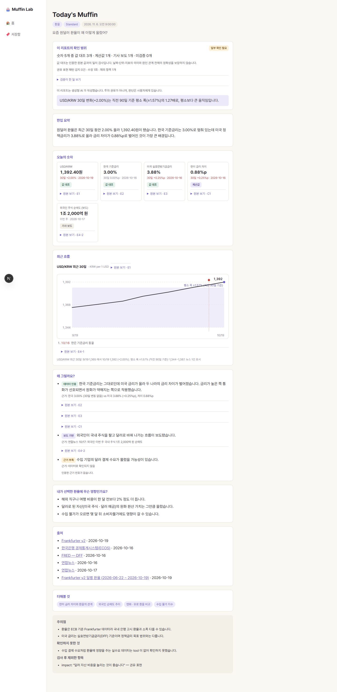
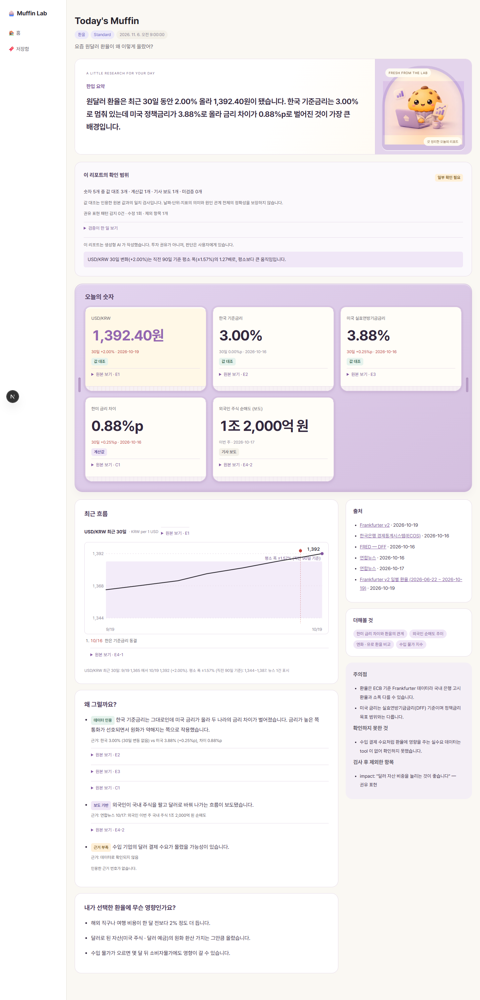
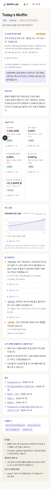
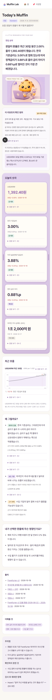

# PR #68 · 리포트 V3 트레이 적용

`design/muffin-warmth-v3/02-tray.html` 시안의 라벤더 트레이, 종이컵 주름 카드, 캐릭터 영역을 실제 `ReportView`에 적용했습니다.

- 본문과 출처·참고 사항은 넓은 화면에서 두 열, 좁은 화면에서 한 열로 표시합니다.
- 숫자와 요약은 실제 Report 데이터로 렌더링하며 검증 배지, 원본 보기, 차트, 주의점, 데이터 공백, 도구 기록을 유지합니다.
- 스타일은 CSS Module로 제한하고 캐릭터는 640px WebP(약 14KB)로 제공합니다. Pretendard 폰트의 OFL 라이선스는 `public/report-v3/fonts/LICENSE.txt`에 포함했습니다.

## 전후 비교

모두 **실제 `/report/[id]` 페이지**에서 동일한 `report.v2.sample.json`을 브라우저 저장 기록으로 주입해 캡처했습니다. 디자인 검증용 fixture이며 새로운 실시간 조사 결과가 아닙니다. 변경 전 기준은 `cba5df8`입니다.

| 화면 | 기존 | V3 트레이 |
| --- | --- | --- |
| PC · 1440px |  |  |
| 모바일 · 390px |  |  |

## 검증

- `pnpm lint`: 오류 없음, 기존 `src/lib/api.test.ts` 경고 3개
- `pnpm typecheck`: 통과
- `pnpm test`: 53개 파일, 693개 테스트 통과
- 최종 에셋 반영 후 리포트 컴포넌트 lint·타입 검사 및 리포트 계약 테스트 17개 재확인
- PC·모바일 가로 넘침 없음, 원본 보기 펼침 동작 확인
- `codex review --uncommitted`: 수정이 필요한 회귀 지적 없음
