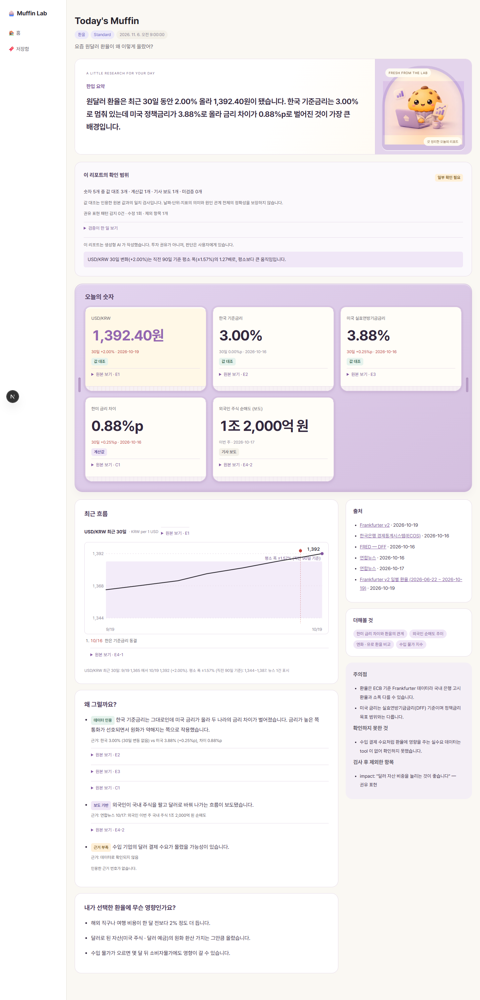
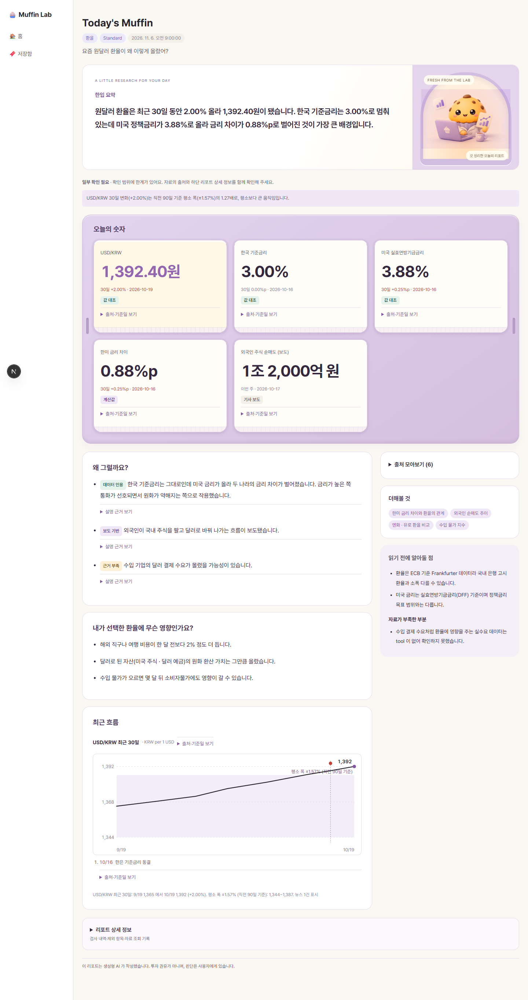
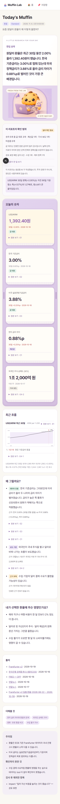
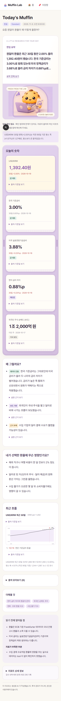

# 리포트 읽기 구성 개선 · 백엔드 협의안

## 이번 프론트 변경

- 한입 요약 → 오늘의 숫자 → 원인 → 생활 영향 순서로 읽습니다. 차트는 본문 뒤에 유지합니다.
- 출처·기준일, 원인별 근거, 출처 목록은 펼쳐서 확인합니다. 숫자별 검증 종류와 근거 부족 표시는 유지합니다.
- 검사 통계·수정 횟수·제외 항목·도구 조회 기록은 하단 `리포트 상세 정보`로 묶고 기본적으로 접습니다.
- 주의점과 자료 부족은 `읽기 전에 알아둘 점`으로 묶되 원문을 모두 남깁니다. 아직 중요도 필드가 없어서 프론트가 임의로 우선순위를 정하거나 생략하지 않습니다.
- 검사 미실행·일부 확인 필요와 서버 `notice`는 접힌 영역 밖에 유지합니다. AI 고지는 하단에 표시합니다.
- 한입 요약은 실제 렌더링에서 4줄을 넘을 때만 전체 보기 버튼이 생깁니다. 웹 21px / 모바일 18px, 전체 보기·접기, 키보드 조작과 상태 안내를 제공합니다. 화면 너비와 폰트 로딩 후 다시 측정합니다.
- 요약 원문, 숫자·단위, 기준일, 저장 기록, API·스키마·검증 로직은 바꾸지 않습니다. 기존 v1 기록도 기존 정규화 경로로 읽습니다.

## 백엔드에 제안할 우선순위

이 문서는 **협의안**이며 구현된 백엔드 계약이 아닙니다. 이번 PR은 아래 작업 없이 동작합니다.

| 순위 | 제안 | 이유 / 담당 협의 |
| --- | --- | --- |
| P1 | 작성 단계에서 요약을 답 1문장 + 근거 1문장, 핵심 숫자 1개 중심으로 생성 | 프론트 접기는 읽기 부담을 덜 뿐, 좋은 요약을 대신하지 못함. 작성 담당과 협의 |
| P1 | 아래 필드별 길이·항목 수를 생성 품질 기준으로 적용하고 초과율 측정 | 모바일과 웹에 서로 다른 사실을 보내지 않고 동일한 짧은 본문 사용. 우선 프롬프트·평가로 적용 |
| P1 | 사용자 주의사항과 내부 진단을 구분할 수 있는 중요도/유형 제공 검토 | `caveats`, `dataGaps`는 지금 문자열 목록이라 프론트가 어떤 경고를 숨겨도 되는지 판단할 수 없음. 스키마 담당/리더와 협의 |
| P2 | 핵심 숫자 표시 우선순위 또는 대표 숫자 선정 | 항목이 많으면 모바일 스크롤이 길어짐. 입력 순서가 우선순위라는 보장이 없으므로 프론트는 임의로 상위 3개만 자르지 않음 |
| P2 | 제외 항목에 사용자 설명과 내부 진단을 분리하는 방안 | 제외된 투자 권유·잘못된 문장을 사용자에게 다시 노출할 필요가 적음. 원본 진단은 운영 기록에 남기고 사용자에게는 설명 범위의 한계만 전달하는 방향 검토 |
| P2 | 숫자 표시용 짧은 표기와 원본 값의 분리 필요성 검토 | `numbers.value`가 단위 포함 문자열이라 프론트에서 축약·반올림하면 정확성이 달라짐. 필요하면 계산/검증 책임자와 계약 합의 후 구현 |

## 제안하는 문구 길이 기준

아래 수치는 **첫 합의용 목표**입니다. 글자 수만으로 줄 수를 보장하지 않습니다. 실제 한국어·영문·긴 단위·320/390/768/1440px 화면을 보고 조정해야 합니다. 공백·문장부호를 포함한 Unicode 코드 포인트 수(`Array.from(text).length`)로 측정하고, 배열은 항목당 길이와 개수를 따로 봅니다.

| 필드 | 권장 목표 | 초과 시 처리 제안 |
| --- | --- | --- |
| `summary` | 60–100자, 1–2문장; 140자 초과는 재작성 후보 | 답을 먼저, 핵심 숫자 1개. 제한 때문에 부정·조건·불확실성·단위를 버리지 않기. 프론트는 길이에 관계없이 원문 전체 보기 제공 |
| `numbers[].label` | 12–24자 | 중복 수식어 줄이기. 지표명·비교 기준 식별은 유지 |
| `numbers[].value` | 임의 글자 제한 없음 | 숫자·부호·소수·단위를 절대 잘라내지 않기. 길면 줄바꿈, 짧은 표기 계약은 별도 협의 |
| `numbers[].change` | 가능하면 15–30자 | 전년/전월/기간, %와 %p 등 의미를 유지. 기준일은 `asOf`에 분리 |
| `why[].claim` | 항목당 45–90자, 2–3개 중심 | 설명 1개당 원인 1개. 세부 수치와 근거는 `evidence`로 분리하되 근거 없는 원인 추가 금지 |
| `why[].evidence` | 항목당 80–160자 목표 | 출처·비교 조건·불확실성을 보존. 상세 영역이므로 필요한 경우 초과 허용 |
| `impact[]` | 항목당 35–70자, 2–3개 | 사용자 영향 하나씩. 매수/매도 등 권유로 바꾸지 않기 |
| `caveats[]`, `dataGaps[]` | 항목당 40–90자 목표 | 중복 제거·쉽게 설명. 중요한 제한은 개수/길이 때문에 누락하지 않기. 심각도 없이 프론트에서 축약 금지 |
| `nextTopics[]` | 항목당 12–24자, 2–3개 | 한 칩에 한 주제. 긴 질문 문장보다 명확한 주제 |
| `notice`, `disclosure` | 의미 보존 우선, 통일된 문구 검토 | 판단 요청·범위 밖·저장된 실행 등 서버 안내와 필수 고지를 기계적으로 자르지 않기 |

### 적용 방식과 완료 조건

1. 우선 현재 필드 그대로 작성 프롬프트와 평가 기준에서 길이·개수를 관리합니다. 바로 Zod `.max()`를 추가해 정상 리포트 전체를 실패시키지 않습니다.
2. 초과하면 생성 단계에서 의미를 보존해 재작성하는 방식과 시간 예산을 협의합니다. 시간 초과 시 기존 유효 원문을 반환하고 프론트 전체 보기로 읽을 수 있게 합니다. 문자열 `slice()`로 자르지 않습니다.
3. 중요도 구분은 예를 들어 사용자 경고(`warning`), 참고(`info`), 내부 진단(`diagnostic`)과 원본 연결을 검토합니다. 명칭·필수 여부는 미정이며 스키마 담당 합의 전 추가하지 않습니다.
4. 새 필드가 필요하면 optional 필드/정규화 등 기존 저장 기록 호환 전략을 먼저 결정합니다. 웹/모바일 폭에 따라 다른 데이터 계약을 만들지 않습니다.
5. 대표 질문(환율·금리·ETF·물가·뉴스, easy/standard/deep)에서 길이 분포, 핵심 숫자·단위 보존, 근거 연결, 불확실성 누락 여부를 함께 검증합니다. 길이가 짧아졌다는 이유만으로 품질 통과 처리하지 않습니다.

## 리뷰 범위와 전달 사항

- `ReportEvidence.tsx`는 담당표상 소희 영역입니다. 이번 변경은 **사용자가 요청한 표시 방식 정리**이며 원본 연결·검증 계산·데이터 모양은 유지했습니다. 출처 문구와 검증 표시 위치를 담당자에게 리뷰 요청할 항목입니다.
- 백엔드/작성 단계/스키마/공용 API는 수정하지 않았습니다. 위 협의안은 별도 후속 작업이며 이번 프론트 PR의 선행 조건이 아닙니다.
- #68이 아직 열려 있어 새 PR의 비교 기준은 `feat/web-home-stream`입니다. **새 PR을 먼저 그 브랜치에 머지하면 #68도 바뀌므로**, #68 머지 후 새 PR의 base를 main으로 전환하고 병합하세요. 제안이 채택되지 않으면 새 PR만 닫으면 됩니다.

## 화면 비교

기존은 #68의 `eb73883`, 이후는 이 PR입니다. 같은 `report.v2.sample.json`과 같은 생성일을 실제 `/report/[id]` 페이지에 넣은 디자인 검증 캡처이며 실시간 조사 결과가 아닙니다.

| 화면 | 기존 트레이 | 정보 구성 개선 |
| --- | --- | --- |
| PC 1440px |  |  |
| 모바일 390px |  |  |

[긴 요약·긴 숫자 모바일 검증](screenshots/report-reading/long-mobile.png)

## 이번 PR 검증 결과

- lint: 오류 없음, 기존 `src/lib/api.test.ts` 미사용 인자 경고 3개
- typecheck 통과 / 전체 53개 파일·696개 테스트 통과
- 리포트 테스트: 검사 미실행·부분 검사 표시, 기본 접힘, 주의점/서버 안내/AI 고지 노출, 원문 보존, 기존 v1 기록과 근거 연결 확인
- 실제 로컬 페이지 브라우저 검사: 기본/긴 요약/짧은 요약/검사 미실행/빈 데이터 5종, 320·390·768·1440px에서 총 9개 조합 통과
- 요약 전체 보기·접기, 짧은 요약 버튼 미노출, 숫자 출처 펼침, 검증 상세 펼침과 Enter 키 접기, 가로 넘침 없음 확인
- 캡처는 fixture를 저장 기록으로 주입한 화면 검증입니다. 이번 변경에서 새 실시간 API 조사는 실행하지 않았습니다.
