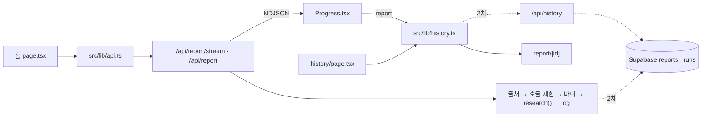

# 머핀 Web 명세서: 백엔드 · 프론트 할 일과 계약

백엔드와 프론트가 맞춰야 할 계약과 각자 할 일을 한 파일에 모았습니다. 이 파일을 그대로 AI 에게 주고 자기 이름의 할 일을 맡기면 됩니다. 날짜는 정하지 않고 순서(6절)만 둡니다. 첫 목표는 홈 → 진행 → 상세 → 저장함 흐름을 Mock 으로 시연하는 것입니다.

## 0. AI 에게 맡길 때 지킬 것

1. 이 파일 전체와 `AGENTS.md` 를 먼저 읽고, 5절에서 **자기 이름의 할 일만** 합니다.
2. 고치는 파일은 2절에서 자기 담당인 것만입니다. 다른 파일이 필요하면 멈추고 사람에게 묻습니다.
3. 3 · 4절의 계약(요청 · 응답 · 이벤트 · 함수 모양 · 표)은 바꾸지 않습니다. 바꿔야 하면 멈추고 Discord 에 "어느 화면에 어떤 필드" 로 적습니다.
4. 6절의 "먼저 끝나야 하는 것" 이 아직 머지 전이면 그 파일은 건드리지 않고 기다립니다.
5. Next.js 16 입니다. 코드를 쓰기 전에 `node_modules/next/dist/docs/` 에서 해당 문서를 읽습니다.
6. 브랜치는 `feat/<영역>-<내용>`, 커밋은 `feat:` · `fix:` · `test:` · `docs:` + 한국어 한 줄입니다. main 에 직접 push 하지 않습니다.
7. PR 전에 `pnpm lint && pnpm typecheck && pnpm test` 를 통과시키고, 본문은 `.github/PULL_REQUEST_TEMPLATE.md` 를 따릅니다.
8. 키는 `process.env` 로만 읽고 커밋하지 않습니다. 라이브러리 추가는 Discord 에 공유한 뒤 PR 본문에 적습니다.
9. 화면은 리더에게 받은 실제 키로 개발합니다. `MUFFIN_MOCK=1` 은 키가 막혔을 때와 Mock 시연에만 씁니다.

## 1. 흐름

1. 홈(`app/page.tsx`)에서 질문하면 `streamReport` 가 `POST /api/report/stream` 을 부릅니다. 헤더 `X-Muffin-Client` 는 `api.ts` 가 붙입니다.
2. 라우트는 출처 검사 → 호출 제한 → 바디 검사 → `research()`(분류 → 조사 → 정제 → 작성 → 검증) 순서로 돌고, 진행 이벤트를 NDJSON 으로 흘립니다. 끝나면 실행 로그를 남깁니다.
3. 진행 화면(`Progress.tsx`)이 이벤트를 그립니다. 마지막 `report` 이벤트가 오면 `saveReport` 로 저장하고 `/report/<id>` 로 이동합니다.
4. 상세(`app/report/[id]`)는 `getReport(id)` 로 리포트를 그립니다. 저장함(`app/history`)은 `listReports` · `deleteReport` 를 씁니다.
5. 저장은 1차가 브라우저 localStorage, 2차가 `/api/history` → Supabase 입니다. 실행 로그도 2차부터 Supabase `runs` 표에 들어갑니다.



## 2. 파일과 담당

| 파일 | 하는 일 | 담당 |
| --- | --- | --- |
| `app/page.tsx` | 홈 폼, 스트림 연결, 완료 후 저장 → 상세 이동 | 은경(전환) → 은선(스트림) → 하니(폼) 순서 |
| `app/components/Progress.tsx` (신규) | 다섯 단계 진행 화면 | 은선 |
| `app/components/ReportView.tsx` | 리포트 칸 순서 · 배치 | 은선 |
| `app/components/ReportEvidence.tsx` | 숫자 배지 · 원인 아이콘 · 원본 보기 · 계산 계보 · 출처 · 검증 한 줄 | 소희 |
| `app/components/ReportNotice.tsx` (신규) | 판단 요청 · 범위 밖 배너, AI 고지 | 하니 |
| `app/history/page.tsx`, `app/report/[id]/page.tsx` | 저장함 · 상세 화면 | 하니 (비동기 전환의 호출부 수정만 은경) |
| `app/components/useHistory.ts` (선택) | 비동기 history 를 화면에서 쓰는 훅 | 하니 |
| `app/layout.tsx`, `app/components/Sidebar.tsx`, `app/globals.css` | 공용 | 전원 (바꾸기 전 Discord 한 줄) |
| `src/lib/api.ts`, `src/lib/client.ts` (신규) | fetch 창구, 브라우저 익명 id | 리더 |
| `src/lib/history.ts` | 저장 함수 5개 | 은경 |
| `app/api/report/route.ts`, `app/api/report/stream/route.ts` | 리포트 생성 API | 서영(호출 제한 · 에러 코드 · 실행 로그) → 은경(출처 검사 · 바디 크기) |
| `src/lib/ratelimit.ts` (신규) | 호출 제한 | 서영 |
| `src/lib/log.ts` | 실행 로그, `RunStage` 에 `limited`, 2차 `runs` 저장 | 서영 |
| `src/lib/guard.ts` (신규. `src/agent/guard.ts` 와 다른 파일) | 출처 검사, 바디 크기 | 은경 |
| `src/lib/db.ts` (신규) | Supabase 서버 클라이언트 | 은경 |
| `app/api/history/route.ts`, `app/api/history/[id]/route.ts` (신규) | History API | 은경 |
| `supabase/migrations/*.sql` (신규) | 표 정의. 적용은 리더 | 은경 |
| `src/agent/events.ts`, `src/agent/schema.ts` | 이벤트 · 리포트 모양 | 리더 (변경은 Discord 로 요청) |

## 3. 계약: 리포트 생성

### 3.1 요청 · 응답

| 항목 | 내용 |
| --- | --- |
| 경로 | `POST /api/report/stream` (진행 화면용 NDJSON). `POST /api/report` (JSON 한 번에. 스트림이 안 될 때 대체 · curl 확인용) |
| 요청 바디 | `{ question: string, depth?: "easy" \| "standard" \| "deep", area?: "fx" \| "etf" \| "news" \| "rate" \| "macro" }`. question 은 trim 후 1~500자, depth 기본 standard |
| 요청 헤더 ✚ | `X-Muffin-Client: <uuid v4>` 브라우저 익명 id. `api.ts` 가 자동으로 붙임. 서버는 `readClientId(req.headers)`(`src/lib/client.ts`)로 읽고, 없거나 uuid v4 가 아니면 undefined → IP 로 처리 |
| 요청 id | `newRunId()`. 응답의 `id`, 스트림 헤더 `X-Request-Id`, 로그, 저장 기록 id 가 모두 같은 값 |
| 200 (JSON) | `{ report: Report, steps: ToolStep[], rewrites: number, id: string }` |
| 400 | `{ error: "question(필수), depth, area 를 확인하세요.", id }` |
| 403 ✚ | `{ error: "허용되지 않은 출처입니다.", id }` 출처 검사 실패 (은경) |
| 413 ✚ | `{ error: "요청이 너무 큽니다.", id }` 바디 크기 초과 (은경) |
| 429 ✚ | `{ error: "요청이 많아요. N분 뒤 다시 시도해 주세요.", id, retryAfterSec }` + 헤더 `Retry-After: <초>` (서영) |
| 503 | `{ error: "리포트 서비스 설정을 확인해 주세요.", id }` 키 없음. JSON 라우트는 지금 500 이라 503 으로 통일 ✚ (서영) |
| 500 | `{ error: "조사 중 오류가 발생했습니다. 잠시 후 다시 시도해 주세요.", id }` 실행 중 실패 |

- 라우트 처리 순서: 출처 검사(403) → 호출 제한(429, 헤더만 봄) → 바디 크기(413) · 형식(400) → 키 확인(503) → `research()`.
- 스트림 라우트도 400 · 403 · 413 · 429 · 503 은 스트림을 열기 전에 JSON 으로 돌려줍니다. `streamReport` 가 `!res.ok` 로 잡아 `ApiError`(`status` · `id` · `retryAfterSec`, message 는 `"<error> (요청 id: <id>)"`)를 throw 합니다.
- 55초 제한(`STREAM_TIMEOUT_MS`): 넘으면 `error` 이벤트 "조사 시간이 초과되었습니다…" 를 보내고 닫습니다. 실제 소요는 30~60초입니다.
- 에러 · 이벤트 · 로그는 `redactSecrets` 를 거칩니다 (이미 있음).
- `MUFFIN_MOCK=1` 이면 같은 라우트가 키 없이 샘플 리포트와 다섯 단계 이벤트를 지연을 두고 보냅니다. 질문에 "사도 돼" 가 있으면 판단 요청 샘플입니다.

### 3.2 스트림 이벤트 (`src/agent/events.ts`, 한 줄에 JSON 하나)

| type | 필드 | 언제 | 화면 |
| --- | --- | --- | --- |
| `stage` | `stage: "plan" \| "research" \| "edit" \| "write" \| "verify"`, `status: "start" \| "done"` | 단계 시작 · 끝 | 단계 표시. 라벨은 `stageLabels` (질문 파악 · 데이터 조사 · 사실 정리 · 리포트 작성 · 검증) |
| `plan` | `intent`, `mode`, `tools: string[]` | 분류 끝 | "이렇게 조사할게요" 한 줄. tool 이름은 `labelFor(name)` |
| `step` | `step: { tool, status: "ok" \| "error", ms, error? }` | tool 하나 끝날 때마다 | tool 한 줄. 계산 step 은 edit 단계 안에서 옴 |
| `verify` | `verification` | 검증 끝 | 검증 한 줄 |
| `report` | `report`, `steps`, `rewrites`, `id` | 마지막 줄 | 저장 후 상세로 이동 |
| `error` | `message`, `id?` | 실패 · 시간 초과 (마지막 줄) | 메시지 + 요청 id + 다시 시도 |

- 단계 이벤트는 단계마다 한 번만 옵니다. 검증 실패로 작성을 1회 다시 돌리면 verify 단계 안에서 처리하고 write 이벤트를 다시 보내지 않습니다. 그래서 verify 가 10~15초 길어질 수 있습니다.
- 범위 밖 질문은 plan 뒤에 research · edit · write 없이 verify → report 로 끝납니다. 건너뛴 단계를 표시해야 합니다.

### 3.3 리포트 필드 → 화면 (`src/agent/schema.ts` 의 `reportSchema`)

| 필드 | 화면 | 담당 |
| --- | --- | --- |
| `mode` (research · decision_facts · out_of_scope), `notice` | 상단 배너. 문구는 서버가 준 것을 그대로 | 하니 |
| `disclosure` | AI 생성 고지, 리포트 하단 고정 | 하니 |
| `summary`, `impact[]`, `caveats[]`, `dataGaps[]`, `nextTopics[]` | 각 칸 | 은선 |
| `numbers[]` (`check`: verified · derived · unverified, `ref`) | 숫자 카드, 배지, 원본 보기 | 소희 |
| `why[]` (`basis`: data 📊 · news 📰 · none ❔, `refs`) | 원인, 아이콘, 원본 보기 | 소희 |
| `evidence[]` (E1 · E3-1 · C1, `lineage`), `sources[]` | 원본 보기, 계산 계보, 출처 목록 | 소희 |
| `verification` | 검증 한 줄, 검사 후 제외한 항목 | 소희(내용) · 은선(위치) |

정제 단계의 사실 목록(facts)은 리포트에 들어 있지 않습니다.

## 4. 계약: 저장 · 로그 · 보호

### 4.1 `src/lib/history.ts` (프론트는 이것만 씁니다. 함수는 비동기)

```ts
type ReportRecord = {
  id: string;        // 리포트 생성 응답의 요청 id 를 그대로
  createdAt: string; // ISO
  input: { question: string; depth: Depth; area?: Area };
  report: Report;
  steps: ToolStep[];
};

saveReport(input, report, steps, id?: string): Promise<ReportRecord> // id 없으면 새로 만듦
listReports(): Promise<ReportRecord[]>                                // 최신순, 최대 100
getReport(id: string): Promise<ReportRecord | undefined>
deleteReport(id: string): Promise<void>
subscribeHistory(listener: () => void): () => void                    // 그대로
```

- 지금은 동기 함수이고 화면 세 곳이 부릅니다: `app/page.tsx` 의 `saveReport`, `app/history/page.tsx` 와 `app/report/[id]/page.tsx` 의 `useSyncExternalStore`. 전환 PR(은경)이 이 세 곳을 `await saveReport(...)` 와 `useEffect` + 상태(불러오는 중 · 없음 · 있음)로 같이 고칩니다. 하니는 이 PR 이 머지될 때까지 두 페이지를 고치지 않습니다.
- 1차: 구현은 localStorage(`muffin.history.v1`) 그대로 두고 함수만 Promise 를 돌려줍니다.
- 2차: History API 호출로 바꾸고 `X-Muffin-Client` 는 `getClientId()` 로 붙입니다. 1차 브라우저 기록은 서버로 옮기지 않습니다.
- 읽을 때 `normalizeReport` 로 v1 기록을 v2 모양으로 맞추는 것은 유지합니다.

### 4.2 History API (2차, 은경)

| 요청 | 응답 |
| --- | --- |
| `GET /api/history?limit=20&before=<ISO>` | 200 `{ records: ReportRecord[] }` 최신순 |
| `GET /api/history/:id` | 200 `{ record }` · 404 `{ error, id }` (다른 브라우저의 기록도 404) |
| `POST /api/history`, 바디 `{ id?, input, report, steps }` | 201 `{ record }`. report 는 `reportSchema.parse`, steps 100개 이하, 바디 512KB 이하. 같은 브라우저가 같은 id 를 다시 보내면 200 으로 기존 것, 다른 브라우저의 id 면 409 |
| `DELETE /api/history/:id` | 204 · 404 |
| 공통 | 헤더 `X-Muffin-Client` 가 없거나 uuid 가 아니면 400 (`readClientId` 가 undefined). 출처 검사(4.6) 적용. 브라우저당 100개를 넘으면 오래된 것부터 삭제. 호출 제한은 없음 |

로그인은 넣지 않습니다(맨 뒤 순위). 나중에 붙여도 표에 `user_id` 열만 더하면 되게 둡니다. 한계: 브라우저 id 를 아는 사람은 그 브라우저의 기록을 볼 수 있습니다.

### 4.3 DB: Supabase Postgres (리더 소유 조직, 무료 플랜, 리전 서울, 프로젝트 `muffin`)

- 서버 전용 환경 변수: `SUPABASE_URL`, `SUPABASE_SECRET_KEY`(`sb_secret_` 로 시작). `NEXT_PUBLIC_` 를 붙이지 않고, 브라우저용 publishable 키는 쓰지 않습니다.
- 라이브러리는 `@supabase/supabase-js` 하나입니다. RLS 는 켜고 정책은 만들지 않습니다 (secret 키만 표에 닿음).
- 마이그레이션은 `supabase/migrations/<타임스탬프>_init.sql` 로 커밋하고, 적용은 리더가 SQL Editor 에서 합니다.
- 무료 플랜은 7일 동안 요청이 적으면 일시 정지됩니다. 다시 켜면 데이터는 그대로입니다.

```sql
create table reports (
  id text primary key,                 -- 요청 id
  client_id uuid not null,
  created_at timestamptz not null default now(),
  input jsonb not null,                -- { question, depth, area }
  report jsonb not null,               -- Report v2
  steps jsonb not null default '[]'
);
create index reports_client_created on reports (client_id, created_at desc);

create table runs (                    -- src/lib/log.ts 의 RunLog 와 같은 필드
  id text primary key,
  at timestamptz not null,
  ok boolean not null,
  stage text not null,                 -- started | input | config | limited | agent | ok
  mock boolean not null default false,
  client_id uuid,
  ip_hash text,                        -- sha256(ip + RATE_LIMIT_SALT) 앞 16자. 원문 IP 는 저장하지 않음
  input jsonb,                         -- { question, depth, area }
  ms integer not null,
  model text,
  usage jsonb,                         -- { requests, inputTokens, outputTokens }
  steps jsonb,
  rewrites integer,
  quality jsonb,
  verification jsonb,                  -- { status, numbers, why, advice, revisions }
  intent text,
  error text
);
create index runs_at on runs (at desc);
create index runs_client_at on runs (client_id, at desc);
create index runs_ip_at on runs (ip_hash, at desc);

-- RLS 는 켜고 정책은 만들지 않습니다. secret 키만 표에 닿습니다.
alter table reports enable row level security;
alter table runs enable row level security;
```

### 4.4 실행 로그 (서영)

`logRun` 은 지금처럼 콘솔(Vercel Logs, `muffin.run`)에 남기고, 2차부터 `runs` 에도 남깁니다. 요청의 줄은 호출 제한 v2 가 시작할 때 먼저 넣고(4.5), 끝나면 `logRun` 이 같은 id 의 줄을 갱신합니다. 갱신은 응답을 늦추지 않게 `next/server` 의 `after()` 로 하고, 실패해도 응답은 그대로 나가게 try/catch 후 콘솔에만 남깁니다. `db.ts` 는 은경의 것을 씁니다.

### 4.5 호출 제한 (서영)

- 키 두 개를 함께 셉니다. 브라우저 키는 `readClientId(req.headers)` 값(없으면 IP 키만), IP 키는 `x-forwarded-for` 의 첫 IP 를 `RATE_LIMIT_SALT` 와 함께 sha256 한 값입니다. 원문 IP 는 저장 · 로그하지 않습니다.
- 한도는 환경 변수에서만 읽습니다(비우면 기본값): 브라우저 키 `RATE_LIMIT_10M=10`(10분 10회) · `RATE_LIMIT_DAY=60`(하루 60회), IP 키 `RATE_LIMIT_IP_10M=30`(10분 30회). 숫자를 코드 곳곳에 쓰지 않고 기본값은 `ratelimit.ts` 한 곳에 둡니다. 상한은 Vercel 환경 변수만 바꿔 올립니다.
- 리포트 생성 두 라우트에만, 바디를 읽기 전에 적용합니다(출처 검사 바로 뒤). 넘으면 429 와 `Retry-After`, 로그는 `stage: "limited"` 입니다.
- v1 은 메모리 `Map` 입니다. 인스턴스마다 따로 세는 한계를 파일 머리에 적습니다.
- v2(2차)는 요청을 받자마자 `runs` 에 그 요청의 줄을 먼저 넣고(`stage: "started"`), 그 줄까지 포함해 셉니다. 한도를 넘으면 그 줄을 `limited` 로 바꾸고 429 를 돌려줍니다. 끝난 요청만 세면 동시에 들어온 요청이 모두 통과하기 때문입니다.

```ts
// src/lib/ratelimit.ts (모양 고정. 구현을 바꿔도 라우트는 그대로)
export async function checkLimit(keys: { clientId?: string; ipHash: string }): Promise<{ ok: true } | { ok: false; retryAfterSec: number }>;
```

### 4.6 출처 검사 · 바디 크기 (은경)

- POST · DELETE 라우트 전부에서 Origin(없으면 Referer)이 `ALLOWED_ORIGINS`(쉼표 구분)에 없으면 403 입니다. 기본값은 `https://muffin-kappa.vercel.app`, `https://*-thdude37-2971s-projects.vercel.app`, `http://localhost:3000` 입니다. 둘 다 없는 요청(curl 등)은 개발 환경에서만 통과합니다.
- 출처 검사는 라우트 맨 앞(호출 제한보다 앞)에 둡니다. 바디는 지금의 `req.json()` 대신 `readJsonLimited` 로 읽습니다. 한도는 리포트 생성 16KB, History POST 512KB 이고, 넘으면 413 입니다.
- `pnpm eval` 은 라우트를 거치지 않으므로 영향이 없습니다.

```ts
// src/lib/guard.ts
export function checkOrigin(req: Request): { ok: true } | { ok: false; status: 403 };
export async function readJsonLimited(req: Request, maxBytes: number): Promise<unknown>; // 넘으면 throw → 413
```

## 5. 할 일과 완료 조건

### 백엔드

| 누구 | 할 일 | 완료 조건 |
| --- | --- | --- |
| 은경 | history 비동기 전환: `history.ts` 함수 5개를 Promise 로(`saveReport` 에 `id?` 추가), 화면 세 곳 호출부까지. 구현은 localStorage 그대로 | 세 화면이 전과 같이 동작, `pnpm test` 통과, 하니에게 미리 알림 |
| 서영 | 호출 제한 v1: `ratelimit.ts` + 테스트, 두 라우트에서 바디를 읽기 전에 호출, 429, `RunStage` 에 `limited`, JSON 라우트 키 없음 500 → 503 | 11번째 요청 429 + `Retry-After`, 브라우저 id 를 바꿔도 IP 상한에서 429, 가짜 시계로 10분 뒤 풀림, 환경 변수로 한도가 바뀜, 라우트 테스트에 429 응답 1건 |
| 은경 | 출처 검사 · 바디 크기: `src/lib/guard.ts` + 테스트, 두 라우트에 적용 | 허용 Origin 통과, 다른 Origin 403, 큰 바디 413 |
| 은경 | DB · History API: `db.ts`, 마이그레이션 SQL, 엔드포인트 4개 + 테스트(Supabase 클라이언트는 모킹), `history.ts` 2차 구현 | 같은 브라우저에서만 보이고 다른 브라우저에서는 안 보임, 삭제 동작 |
| 서영 | 실행 로그 DB: `logRun` 이 `runs` 에도 insert | Supabase 표에 한 줄, 쓰기가 실패해도 응답은 그대로 |
| 서영 | 호출 제한 v2: 요청 시작 때 `runs` 에 먼저 넣고 세기 | 인스턴스가 달라도 같은 수로 셈, 같은 브라우저에서 동시에 11건이 와도 10건만 통과 |

### 프론트

| 누구 | 할 일 | 쓰는 계약 | 완료 조건 |
| --- | --- | --- | --- |
| 은선 | 진행 화면 `Progress.tsx`: 다섯 단계(대기 · 진행 · 완료 · 건너뜀), plan 한 줄, step 목록(라벨 · 성공/실패 · 시간), verify 한 줄, error(메시지 · 요청 id · 다시 시도) | 3.2 | Mock 으로 다섯 단계가 순서대로 보임, 범위 밖("비트코인 지금 얼마야?")에서 건너뛴 단계 표시, 55초 초과 메시지 표시 |
| 은선 | 홈 스트림 연결: `createReport` → `streamReport`, 끝나면 `await saveReport(input, report, steps, result.id)` 후 `/report/<id>` 로 이동 | 3.1, 4.1 | 실제 키로 질문 → 진행 → 상세까지 한 번에 |
| 은선 | 리포트 칸 배치: `ReportView.tsx` 의 칸 순서 · 묶음, 소희 · 하니 부품 배치 | 3.3 | 모임에서 화면 제안 |
| 하니 | 배너 · AI 고지 `ReportNotice.tsx`: mode 별 배너, disclosure 하단 고정. `ReportEvidence.tsx` 의 `ReportVerification` 안에 있는 고지 글자를 이리로 옮김(소희와 순서 조율) | `mode` `notice` `disclosure` | "KODEX 200 지금 사도 돼?" 에서 배너, 모든 리포트에 고지 |
| 하니 | 홈 폼: 영역 · 깊이 · 질문, 키보드 조작, 오류 표시(429 메시지 포함) | 3.1 | 키보드만으로 제출 가능 |
| 하니 | 저장함 · 상세 화면: 목록 · 삭제 · 빈 상태 · 불러오는 중, 상세의 없음 처리 | 4.1 | 세 상태가 보임 |
| 소희 | 숫자 배지 · 원인 아이콘: `check` 3종, `basis` 3종 디자인 | 3.3 | Mock 에서 세 상태 모두 확인 |
| 소희 | 원본 보기 · 계산 계보: ref → evidence 항목(라벨 · 값 · 출처 · 기준일 · note), lineage 면 입력 E 번호로 이동, 뉴스 기사별 항목, 출처 목록 | 3.3 | C1 을 누르면 계산식과 E1 · E2 로 이동 |
| 소희 | 검증 한 줄 내용 | `verification` | "숫자 3개 중 2개 값 대조 · 1개 계산값 · 권유 0" 형태 |

프론트 공통: fetch 는 `src/lib/api.ts` 만, 저장은 `src/lib/history.ts` 만 씁니다. 화면 테스트는 `app/components/ReportView.test.tsx` 와 같은 방식(vitest)입니다.

### 리더

- `src/lib/client.ts` 의 `getClientId()`: `crypto.randomUUID()` 를 localStorage `muffin.client` 에 저장하고, 서버 렌더링에서는 빈 문자열을 돌려줍니다. `api.ts` 가 `X-Muffin-Client` 를 자동으로 붙이고, 429 의 `retryAfterSec` 를 에러 메시지에 반영합니다.
- Supabase 새 조직 · 프로젝트 · 키를 만들고, `.env.local` 과 Vercel 환경 변수(`SUPABASE_URL` · `SUPABASE_SECRET_KEY` · `ALLOWED_ORIGINS` · `RATE_LIMIT_*` · `RATE_LIMIT_SALT`)에 넣습니다. 마이그레이션도 적용합니다.
- `events.ts` · `schema.ts` 변경 창구와 AGENTS.md 관리, 응답 시간(55초) 줄이기를 맡습니다.

## 6. 순서

| 단계 | 누구 | 할 일 | 먼저 끝나야 하는 것 |
| --- | --- | --- | --- |
| 1. Mock 시연 | 은경 | history 비동기 전환 PR (화면 세 곳 호출부 포함) | 없음 |
| 1. Mock 시연 | 리더 | `client.ts` + `api.ts` 식별 헤더 | 없음 |
| 1. Mock 시연 | 은선 · 하니 · 소희 | `Progress.tsx` · `ReportNotice.tsx` · `ReportEvidence.tsx` (새 파일이거나 각자 파일이라 바로 시작) | 없음 |
| 1. Mock 시연 | 서영 | `ratelimit.ts` + 테스트 | 없음 |
| 1. Mock 시연 | 은선 | `page.tsx` 스트림 연결 | 은경 전환 PR 머지 |
| 1. Mock 시연 | 하니 | `page.tsx` 폼 · 오류, 저장함 · 상세 화면 | 은선 `page.tsx` PR 머지 (같은 파일) |
| 1. Mock 시연 | 서영 | 라우트에 호출 제한 연결, 429, 503 통일 | 없음 |
| 1. Mock 시연 | 은경 | `guard.ts` + 라우트 적용 | 서영 라우트 PR 머지 (같은 파일) |
| 1. Mock 시연 | 전원 | Mock 으로 홈 → 진행 → 상세 → 저장함 시연 | 위 화면 PR |
| 2. Supabase | 리더 | 조직 · 프로젝트 · 키 · Vercel 환경 변수, 마이그레이션 적용 | 없음 |
| 2. Supabase | 은경 | `db.ts` · 마이그레이션 SQL · History API · `history.ts` 2차 | 리더 키 전달 |
| 2. Supabase | 서영 | `runs` 로그 저장 → 호출 제한 v2 | 은경 `db.ts` · 마이그레이션 머지 |
| 2. Supabase | 하니 | 저장함 서버 전환 확인 | 은경 History API 머지 |
| 3. 시연 | 전원 | 실제 키로 홈 → 진행 → 상세 → 저장함 | 2단계 |

같은 파일을 여러 사람이 고치는 곳은 넷입니다: `app/page.tsx`(은경 → 은선 → 하니), 저장함 · 상세 페이지(은경 → 하니), 두 라우트(서영 → 은경), `ReportEvidence.tsx`(소희 → 하니, 고지 글자 옮기기). 뒤 사람은 앞 사람 PR 이 머지된 뒤 `git pull` 하고 시작합니다. 순서 조율은 Discord 의 별도 채널에서 하고, 바뀐 순서는 이 표에 적습니다.

## 7. 자주 나올 질문

- **키 없이 화면을 만들 수 있나?** `MUFFIN_MOCK=1` 로 모든 이벤트와 리포트 상태를 볼 수 있습니다. 마무리 확인은 실제 키로 합니다.
- **History 가 비동기가 되면 지금 화면이 깨지나?** 은경의 전환 PR 이 세 화면의 호출부를 같이 고치므로 머지 직후에도 동작합니다.
- **429 가 오면 화면은?** `streamReport` · `createReport` 가 `ApiError` 를 throw 합니다. 홈은 `message`("요청이 많아요… (요청 id: …)")를 그대로 보여 주고, `retryAfterSec` 동안 다시 시도 버튼을 막을 수 있습니다.
- **리포트에 필드를 더하고 싶다.** 코드에서 바꾸지 말고 Discord 에 "어느 화면에 어떤 필드" 로 적습니다. 리더가 `schema.ts` 와 이 문서를 고칩니다.
- **테스트는 어디까지?** 백엔드는 라우트 · 헬퍼 단위 테스트(외부는 모킹), 프론트는 컴포넌트 테스트입니다. 실제 키로 확인한 것은 PR 본문 "테스트 방법" 에 적습니다.
