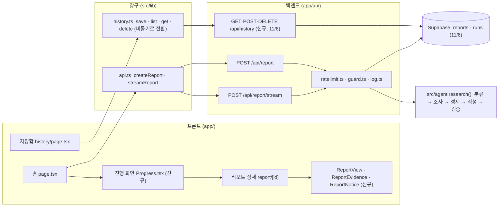

# 머핀 Web 명세서: 백엔드 · 프론트 할 일과 API 계약

2026-10-26 작성 (리더). 기준 일정은 10/30(금) 모임 → 11/6(금) 모임 → 11/13 시연입니다.

이 문서는 백엔드와 프론트가 서로 맞춰야 할 **계약**(요청 · 응답 · 이벤트 · 저장 함수)과 **각자 할 일**을 한 곳에 적은 것입니다. 모양이 코드에 있는 것은 파일을 가리킵니다. 계약을 바꿀 일이 생기면 Discord 에 "어느 화면에 어떤 필드" 로 적고, 리더가 코드와 이 문서를 같이 고칩니다.

- 이벤트 모양: `src/agent/events.ts` · 리포트 모양: `src/agent/schema.ts` · 호출: `src/lib/api.ts` · 저장: `src/lib/history.ts`
- 최소 범위(11/13 시연 기준)와 담당은 README "최소 범위와 연결 순서 (10/25 모임)" 과 같습니다. 이 문서는 그것을 할 일 단위로 풀어 쓴 것입니다.

---

## 1. 전체 그림



### 파일과 담당

| 파일 | 하는 일 | 담당 | 비고 |
|---|---|---|---|
| `app/page.tsx` | 홈 폼, 진행 화면 연결, 완료 후 저장 → 상세로 이동 | 하니(폼 · 상태) · 은선(스트림 연결) | 두 사람이 만지므로 순서는 8절 |
| `app/components/Progress.tsx` (신규) | 다섯 단계 진행 화면 | 은선 | |
| `app/components/ReportView.tsx` | 리포트 한 장의 칸 순서와 배치 | 은선 | 안의 부품은 아래 두 파일에서 가져옴 |
| `app/components/ReportEvidence.tsx` | 숫자 배지 · 원인 아이콘 · 원본 보기 · 계산 계보 · 출처 링크 · 검증 한 줄 | 소희 | |
| `app/components/ReportNotice.tsx` (신규) | 판단 요청 · 범위 밖 배너, AI 고지 | 하니 | 지금은 `ReportEvidence.tsx` 의 `ReportVerification` 안에 글자만 있음 |
| `app/history/page.tsx`, `app/report/[id]/page.tsx` | 저장함 목록, 상세 페이지 틀 | 하니 | 비동기 history 로 전환 |
| `app/components/useHistory.ts` (선택) | 비동기 history 를 화면에서 쓰는 훅 | 하니 | |
| `app/layout.tsx`, `app/components/Sidebar.tsx`, `app/globals.css` | 공용 | 전원 | 바꾸기 전에 Discord 한 줄 |
| `src/lib/api.ts` | 프론트가 쓰는 유일한 fetch 창구 | 리더 | 10/28 식별 헤더 추가 |
| `src/lib/history.ts` | 저장 함수 5개. 1차 localStorage, 2차 History API | 은경 | 3절 |
| `src/lib/client.ts` (신규) | 브라우저 익명 id (`X-Muffin-Client`) | 리더 | api.ts · history.ts 가 같이 씀 |
| `app/api/report/route.ts`, `app/api/report/stream/route.ts` | 리포트 생성 API | 서영(호출 제한 · 에러 코드) · 은경(출처 검사 · 로그 DB) | 각자 한 줄씩 호출만 넣고 구현은 아래 파일에 |
| `src/lib/ratelimit.ts` (신규) | 호출 제한 | 서영 | |
| `src/lib/guard.ts` (신규) | 출처(Origin) 검사, 바디 크기 | 은경 | |
| `src/lib/log.ts` | 실행 로그 1줄. 2차에 `runs` 표 저장 추가 | 은경 | `RunStage` 에 `limited` 추가는 서영 |
| `src/lib/db.ts` (신규) | Supabase 서버 클라이언트 | 은경 | 서버 전용 키 |
| `app/api/history/route.ts`, `app/api/history/[id]/route.ts` (신규) | History API | 은경 | 11/6 |
| `supabase/migrations/*.sql` (신규) | 표 정의 | 은경 | 적용은 리더 |
| `src/agent/events.ts`, `src/agent/schema.ts` | 이벤트 · 리포트 모양 | 리더 | 변경은 Discord 로 요청 |

---

## 2. API 계약: 리포트 생성

두 라우트는 이미 있습니다 (리더 PR #24 · #27). 아래는 지금 동작 + 이번에 추가할 것(✚ 표시)입니다.

### 2.1 공통

| 항목 | 내용 |
|---|---|
| 요청 바디 | `{ question: string, depth?: "easy" \| "standard" \| "deep", area?: "fx" \| "etf" \| "news" \| "rate" \| "macro" }`. `question` 은 trim 후 1~500자, `depth` 기본 `standard`. zod `bodySchema` 가 검사 |
| 요청 헤더 ✚ | `X-Muffin-Client: <uuid v4>`. 브라우저 익명 id. `api.ts` 가 자동으로 붙임(리더). 서버는 형식만 검사하고 없으면 IP 기준으로 처리 |
| 응답 헤더 | 스트림: `X-Request-Id: <id>`, `Cache-Control: no-store`. JSON 응답은 바디의 `id` |
| 요청 id | `newRunId()` 가 만든 문자열. 로그(`muffin.run`) · 에러 메시지 · 저장함 기록 id 를 이 값으로 맞춥니다 |
| 400 | `{ error: "question(필수), depth, area 를 확인하세요.", id }` |
| 403 ✚ | `{ error: "허용되지 않은 출처입니다.", id }`. Origin 검사 실패 (은경) |
| 429 ✚ | `{ error: "요청이 많아요. N분 뒤 다시 시도해 주세요.", id, retryAfterSec }` + 헤더 `Retry-After: <초>` (서영) |
| 503 | `{ error: "리포트 서비스 설정을 확인해 주세요.", id }`. 키 없음. JSON 라우트는 지금 500 을 돌려주는데 503 으로 통일 ✚ (서영) |
| 500 | `{ error: "조사 중 오류가 발생했습니다. 잠시 후 다시 시도해 주세요.", id }`. 실행 중 실패 |
| 비밀값 | 에러 · 이벤트 · 로그에 키가 새지 않게 `redactSecrets` 를 거칩니다 (이미). tool 에러는 밖으로 "데이터를 확인하지 못했습니다." 로만 |

### 2.2 `POST /api/report` (완료 후 JSON 한 번에)

- 200: `{ report: Report, steps: ToolStep[], rewrites: number, id: string }`
- 프론트는 `createReport(input)` 로 부릅니다. 반환 모양이 위와 같습니다.
- 진행 화면이 붙으면 홈은 이 라우트 대신 스트림을 씁니다. 라우트는 유지합니다 (eval · 외부 호출용).

### 2.3 `POST /api/report/stream` (NDJSON 이벤트)

- 200, `Content-Type: application/x-ndjson`. 한 줄에 JSON 하나. 마지막 줄은 `report` 또는 `error` 하나이고 그 뒤 이벤트는 없습니다.
- 400 · 403 · 429 · 503 은 스트림을 열기 전에 JSON 으로 돌아옵니다. `streamReport` 가 `!res.ok` 로 잡습니다.
- 55초 제한: `STREAM_TIMEOUT_MS = 55_000`. 넘으면 `{ type: "error", message: "조사 시간이 초과되었습니다. 질문 범위를 줄여 다시 시도해 주세요.", id }` 를 보내고 닫습니다 (Vercel 함수 상한 60초 전에 이유를 알려 주기 위해). 실제 소요는 30~60초이고, 줄이는 일은 리더가 합니다.
- 브라우저가 연결을 끊으면 출력만 멈추고 에이전트는 끝까지 돕니다 (비용은 발생). 중단 전파는 고도화 과제.

이벤트 6종 (`src/agent/events.ts`):

| type | 필드 | 언제 | 화면 (담당) |
|---|---|---|---|
| `stage` | `stage: "plan" \| "research" \| "edit" \| "write" \| "verify"`, `status: "start" \| "done"` | 단계 시작 · 끝 | 단계 표시. 라벨은 `stageLabels` (질문 파악 · 데이터 조사 · 사실 정리 · 리포트 작성 · 검증) (은선) |
| `plan` | `intent`, `mode`, `tools: string[]` | 분류 끝난 뒤 | "이렇게 조사할게요" 한 줄. tool 라벨은 `labelFor(name)`. `mode === "decision_facts"` 면 판단 요청 안내를 미리 보여도 됨 (은선) |
| `step` | `step: { tool, status: "ok" \| "error", ms, error? }` | tool 하나 끝날 때마다 | tool 한 줄씩. 계산 tool 의 step 은 `edit` 단계 안에서 옴 (은선) |
| `verify` | `verification` | 검증 끝 | "숫자 3개 중 2개 값 대조 · 1개 계산값 · 권유 0" (은선) |
| `report` | `report`, `steps`, `rewrites`, `id` | 끝 | 저장 후 상세로 이동 (은선 → 하니 저장) |
| `error` | `message`, `id?` | 실패 · 시간 초과 | 메시지 + 요청 id, 다시 시도 버튼 (은선) |

흐름: `plan` 단계 → `plan` 이벤트 → `research`(step 들) → `edit`(계산 step) → `write` → `verify`(verify 이벤트) → `report`. 단계 이벤트는 다섯 단계가 각각 한 번씩만 옵니다. 검증에 실패해 작성을 1회 다시 돌릴 때는 **`verify` 단계 안에서** 처리하고 `write` 단계 이벤트를 다시 보내지 않습니다(`src/agent/events.ts` 머리 주석). 그래서 `verify` 단계가 10~15초 길어질 수 있고, 수정 여부는 `report` 이벤트의 `rewrites` 와 `verification.revisions` 로만 알 수 있습니다. **범위 밖 질문**이면 `plan` 뒤에 `research · edit · write` 없이 `verify → report` 로 끝나므로 건너뛴 단계를 표시할 수 있어야 합니다.

### 2.4 Mock

`.env.local` 에 `MUFFIN_MOCK=1` 이면 같은 라우트가 OpenAI · tool 없이 샘플 리포트와 다섯 단계 이벤트를 지연을 두고 보냅니다. 질문에 "사도 돼" 같은 말이 있으면 판단 요청 모드 샘플. 화면은 실제 키로 만들고, 키가 막혔을 때만 Mock 을 씁니다 (AGENTS.md).

---

## 3. 계약: 리포트 필드와 화면

리포트 모양은 `src/agent/schema.ts` 의 `reportSchema` 입니다 (README "리포트 v2" 에 요약). 화면이 쓰는 필드만 적습니다.

| 필드 | 뜻 | 화면 | 담당 | 지금 |
|---|---|---|---|---|
| `mode` | `research` · `decision_facts`(판단 요청) · `out_of_scope`(범위 밖) | 상단 배너 종류 | 하니 | 없음 |
| `notice` | 모드별 안내 문구 (서버가 줌. 판단 요청: "투자 판단을 대신하지 않습니다…", 범위 밖: "머핀이 다루는 범위… 밖의 질문이라…") | 배너 본문. 문구를 화면에서 다시 쓰지 않음 | 하니 | `<p>` 로만 |
| `disclosure` | AI 생성 고지 | 리포트 하단 고정 | 하니 | `<p>` 로만 |
| `summary` | 한입 요약 | 첫 칸 | 은선 | 있음 |
| `numbers[]` | `label` `value` `change` `asOf` `ref?` `check` | 숫자 카드. `check`: `verified` 값 대조 · `derived` 계산값 · `unverified` 미검증. `ref` 로 원본 보기 | 소희 | 배지 있음 |
| `why[]` | `claim` `evidence` `basis` `refs[]` | 원인. `basis`: `data` 📊 · `news` 📰 · `none` ❔. `refs` 로 원본 보기 | 소희 | 배지 있음 |
| `impact[]` `caveats[]` `dataGaps[]` `nextTopics[]` | 영향 · 주의 · 확인 못 한 것 · 더해볼 것 | 칸 | 은선 | 있음 |
| `sources[]` | `id` `name` `url` `asOf`. 코드가 장부에서 만듦. url 없는 계산값은 빠짐 | 출처 목록 | 소희 | 있음 |
| `evidence[]` | `id`(E1, E3-1, C1) `tool` `label` `values` `source` `note?` `lineage?` | 원본 보기. `lineage` 가 있으면 "계산: op ← inputs" 와 입력 E 번호로 이동 | 소희 | 기본 표시 있음 |
| `verification` | `status` `numbers{total,verified,derived,unverified}` `why{…}` `advice` `revisions` `removed[]` | 상단 검증 한 줄, "검사 후 제외한 항목" | 소희(내용) · 은선(위치) | 있음 |
| `charts?` `movement?` | 2단계 | 11월 | | 없음 |

정제 단계가 만든 사실 목록(`facts`)은 리포트에 들어 있지 않습니다. 원본 보기에 필요하면 "어느 화면에 어떤 필드" 로 요청해 주세요.

---

## 4. 계약: 저장함 (History)

### 4.1 프론트는 `src/lib/history.ts` 만 씁니다. 함수는 **비동기**입니다 (1차 PR 에서 전환)

```ts
type ReportRecord = {
  id: string;                 // 리포트 생성 응답의 요청 id 를 그대로 (로그 · 저장 · 화면 주소가 같은 id)
  createdAt: string;          // ISO
  input: { question: string; depth: Depth; area?: Area };
  report: Report;
  steps: ToolStep[];
};

saveReport(input, report, steps, id?: string): Promise<ReportRecord>   // id 없으면 새로 만듦
listReports(): Promise<ReportRecord[]>                                  // 최신순, 최대 100
getReport(id: string): Promise<ReportRecord | undefined>
deleteReport(id: string): Promise<void>
subscribeHistory(listener: () => void): () => void                      // 바뀌면 알림 (그대로)
```

- 지금은 동기 함수이고 화면 세 곳이 `useSyncExternalStore(subscribeHistory, listReports …)` 로 씁니다 (`app/page.tsx` 41행, `app/history/page.tsx` 12행, `app/report/[id]/page.tsx` 15~16행). 비동기가 되면 이 세 곳은 `useEffect` + 상태(불러오는 중 · 없음 · 있음)로 바뀝니다. **전환 PR(은경)에 세 곳의 기계적 수정을 포함**하고 하니가 리뷰합니다. 그 뒤 화면 디자인은 하니가 합니다.
- 1차(10/28~): 구현은 localStorage 그대로, 함수만 Promise 를 돌려줍니다. 화면은 이 모양만 보고 만들면 2차에서 바뀔 게 없습니다.
- 2차(11/6): 구현을 아래 History API 호출로 바꿉니다. `X-Muffin-Client` 는 `src/lib/client.ts` 의 `getClientId()` 로 붙입니다.
- 읽을 때 `normalizeReport` 로 v1 기록을 v2 모양으로 맞추는 것은 유지합니다.

### 4.2 History API (신규, 은경, 11/6)

| 메서드 · 경로 | 요청 | 응답 |
|---|---|---|
| `GET /api/history?limit=20&before=<ISO>` | 헤더 `X-Muffin-Client` | 200 `{ records: ReportRecord[] }` 최신순. `before` 로 다음 페이지 |
| `GET /api/history/:id` | 헤더 | 200 `{ record }` · 404 `{ error, id }` (다른 브라우저의 기록도 404) |
| `POST /api/history` | 헤더, 바디 `{ id?, input, report, steps }` | 201 `{ record }`. `report` 는 `reportSchema.parse`, `steps` 는 배열 · 100개 이하. 바디 512KB 이하. 같은 id 가 있으면 200 으로 기존 것 |
| `DELETE /api/history/:id` | 헤더 | 204 · 404 |
| 공통 | `X-Muffin-Client` 가 없거나 uuid 아니면 400 `{ error, id }`. Origin 검사(4.4) 적용. 브라우저당 100개 넘으면 오래된 것부터 삭제 | |

로그인은 넣지 않습니다. 브라우저 익명 id 로 저장함을 구분하고, 11월 고도화에서 로그인을 붙이더라도 표에 `user_id` 열을 더하는 것으로 끝나게 합니다.

### 4.3 DB: Supabase Postgres (프로젝트 "muffin", 리더가 만듦)

- 환경 변수(서버 전용, `NEXT_PUBLIC_` 금지): `SUPABASE_URL`, `SUPABASE_SERVICE_ROLE_KEY`. 리더가 `.env.local` 과 Vercel 환경 변수에 넣습니다.
- 라이브러리: `@supabase/supabase-js` 1개. 규칙대로 Discord 공유 뒤 PR 본문에 적습니다.
- RLS 는 켜고 정책은 만들지 않습니다. 서버의 service role 키만 표에 닿고, anon 키는 쓰지 않습니다.
- 마이그레이션은 `supabase/migrations/<날짜>_init.sql` 로 레포에 커밋하고, 적용은 리더가 Supabase SQL 편집기에서 합니다.

```sql
create table reports (
  id text primary key,                       -- 요청 id
  client_id uuid not null,
  created_at timestamptz not null default now(),
  input jsonb not null,                      -- { question, depth, area }
  report jsonb not null,                     -- Report v2
  steps jsonb not null default '[]'
);
create index reports_client_created on reports (client_id, created_at desc);

create table runs (                          -- src/lib/log.ts 의 RunLog 와 같은 필드
  id text primary key,
  at timestamptz not null,
  ok boolean not null,
  stage text not null,                       -- input | config | limited | agent | ok
  mock boolean not null default false,
  client_id uuid,
  ip_hash text,                              -- sha256(ip + RATE_LIMIT_SALT) 앞 16자. 원문 IP 는 저장하지 않음
  ms integer not null,
  model text,
  usage jsonb,                               -- { requests, inputTokens, outputTokens }
  steps jsonb,
  rewrites integer,
  quality jsonb,
  verification jsonb,                        -- { status, numbers, why, advice, revisions }
  intent text,                               -- 분류 결과. 에이전트 쪽과 맞춘 뒤 채움
  error text
);
create index runs_at on runs (at desc);
create index runs_client_at on runs (client_id, at desc);
```

### 4.4 실행 로그

`logRun` 은 지금처럼 콘솔(Vercel Logs, `muffin.run`)에 남기고, 2차부터 `runs` 에도 넣습니다. DB 쓰기가 실패해도 응답은 그대로 나가야 하므로 try/catch 로 감싸고 콘솔에만 남깁니다. `/admin` 화면은 11월 리더 몫입니다.

---

## 5. 호출 제한과 보호 (백엔드)

### 5.1 호출 제한 (서영)

- 키: `X-Muffin-Client` 가 있으면 그 값, 없으면 `x-forwarded-for` 의 첫 IP 를 `RATE_LIMIT_SALT` 와 함께 sha256 한 값. 원문 IP 는 저장 · 로그하지 않습니다.
- 한도(환경 변수, 비우면 기본): `RATE_LIMIT_10M=10` (10분에 10회), `RATE_LIMIT_DAY=60` (하루 60회). 리포트 생성 두 라우트에만 적용. History 는 제한하지 않습니다.
- 넘으면 429 (2.1) 와 `Retry-After`. 로그는 `stage: "limited"` (`RunStage` 에 추가).
- 인터페이스를 고정해 구현을 바꿔도 라우트가 안 바뀌게 합니다:

```ts
// src/lib/ratelimit.ts
export async function checkLimit(key: string): Promise<{ ok: true } | { ok: false; retryAfterSec: number }>;
```

- v1 (10/30 까지): 메모리 `Map` 에 시각 목록. Vercel 은 인스턴스마다 따로 세고 콜드 스타트에 비워지지만 데모에는 충분합니다. 이 한계를 파일 머리 주석에 적습니다.
- v2 (11/6 뒤): `runs` 표를 `count` 해서 판단. 은경의 표가 올라온 뒤 교체.
- 테스트(`src/lib/ratelimit.test.ts`): 11번째 요청이 429, 가짜 시계(`vi.useFakeTimers`)로 10분 뒤 풀림, 키가 다르면 따로 셈. 라우트 테스트(`app/api/report/*.test.ts`)에 429 응답 모양 1건.

### 5.2 출처 검사와 바디 크기 (은경)

- POST 라우트 전부: `Origin`(없으면 `Referer`) 이 허용 목록에 없으면 403. 허용 목록은 `ALLOWED_ORIGINS` (쉼표 구분). 기본값: 프로덕션 `https://muffin-kappa.vercel.app`, 미리보기 `https://*-thdude37-2971s-projects.vercel.app`, `http://localhost:3000`. 둘 다 없는 요청(curl 등)은 개발 환경에서만 통과.
- 바디 크기: 리포트 생성 16KB, History POST 512KB. 넘으면 413 `{ error, id }`.
- `pnpm eval` 은 라우트를 거치지 않고 `research()` 를 직접 부르므로 영향 없습니다.
- 테스트: 허용 · 비허용 Origin 각 1건, 크기 초과 1건.

```ts
// src/lib/guard.ts
export function checkOrigin(req: Request): { ok: true } | { ok: false; status: 403 };
export async function readJsonLimited(req: Request, maxBytes: number): Promise<unknown>;   // 넘으면 throw → 413
```

### 5.3 비밀값 · 입력 검증

- 키는 `process.env` 로만, 응답 · 이벤트 · 로그는 `redactSecrets` (이미). Supabase 키도 같은 규칙.
- 입력 검증은 zod `bodySchema` (이미). History 도 zod + `reportSchema`.

---

## 6. 백엔드 할 일

| 누구 | 무엇 | 완료 조건 | 언제 |
|---|---|---|---|
| 은경 | **history 비동기 전환**: `history.ts` 함수 5개를 Promise 로, 화면 세 곳의 호출을 `await` 로. 구현은 localStorage 그대로 | 세 화면이 전과 같이 동작, `pnpm test` 통과, 하니 리뷰 | 10/28 (당일 머지 목표. 프론트 둘이 기다림) |
| 서영 | **호출 제한 v1**: `ratelimit.ts` + 테스트, 두 라우트 맨 앞에서 호출, 429 응답, `RunStage` 에 `limited`, JSON 라우트 키 없음 500 → 503 | 11번째 요청 429 와 `Retry-After`, 라우트 테스트 통과 | 10/29 |
| 은경 | **출처 검사 · 바디 크기**: `guard.ts` + 테스트, 라우트에 적용, `ALLOWED_ORIGINS` | 다른 Origin 403, 큰 바디 413 | 10/29 ~ 11/4 |
| 리더 | Supabase 프로젝트 · 키 · Vercel 환경 변수, `client.ts` + `api.ts` 식별 헤더 | | 10/28 (헤더), 11/3 (DB) |
| 은경 | **DB · History API**: `db.ts`, 마이그레이션 SQL, 엔드포인트 4개 + 테스트(Supabase 클라이언트를 모킹), `history.ts` 2차 구현 | 저장 → 새 브라우저에서 안 보이고 같은 브라우저에서 보임, 삭제 동작 | 11/3 ~ 11/6 |
| 은경 | **실행 로그 DB**: `logRun` 이 `runs` 에도 insert (실패해도 응답 영향 없음) | Supabase 표에 한 줄 생김 | 11/6 |
| 서영 | **호출 제한 v2**: `runs` count 로 교체 | 인스턴스가 달라도 같은 수로 셈 | 11/6 뒤 |

---

## 7. 프론트 할 일

| 누구 | 무엇 | 쓰는 계약 | 완료 조건 | 언제 |
|---|---|---|---|---|
| 은선 | **진행 화면** `Progress.tsx`: 다섯 단계(대기 · 진행 · 완료 · 건너뜀), `plan` 한 줄, `step` 목록(라벨 · 성공/실패 · 시간), `verify` 한 줄, `error`(메시지 · 요청 id · 다시 시도) | 2.3 이벤트 6종, `stageLabels`, `labelFor` | Mock 으로 다섯 단계가 순서대로 보임. 범위 밖("비트코인 지금 얼마야?")에서 건너뛴 단계 표시. 55초 초과 메시지 표시 | 10/28 (Mock) |
| 은선 | **홈에 스트림 연결**: `createReport` → `streamReport`, 완료 시 `await saveReport(input, report, steps, result.id)` 후 `/report/<id>` 이동 | `streamReport`, 4.1 | 실제 키로 질문 → 진행 → 상세까지 한 번에 | 10/29 (은경 전환 PR 뒤) |
| 은선 | **리포트 칸 배치**: `ReportView.tsx` 의 칸 순서 · 묶음, 소희 · 하니 부품 배치 | 3절 | 10/30 모임에서 화면 제안 | 10/30 ~ 11/6 |
| 하니 | **배너 · AI 고지** `ReportNotice.tsx`: `mode` 별 배너(판단 요청 · 범위 밖), `disclosure` 하단 고정. `ReportVerification` 안의 글자는 이 컴포넌트로 옮김(소희와 순서 조율) | `mode` `notice` `disclosure` | "KODEX 200 지금 사도 돼?" 에서 배너, 모든 리포트에 고지 | 10/28 |
| 하니 | **홈 폼**: 영역 · 깊이 · 질문, 키보드 조작, 오류 표시(429 메시지 포함) | 2.1 에러 모양 | 키보드만으로 제출 가능 | 10/29 |
| 하니 | **저장함 · 상세 틀**: 비동기 history 로 목록 · 삭제 · 빈 상태 · 불러오는 중, 상세 페이지의 없음 처리 | 4.1 | 세 상태가 보임 | 10/29 ~ 11/6 |
| 소희 | **숫자 배지 · 원인 아이콘** `ReportEvidence.tsx`: `check` 3종, `basis` 3종(📊📰❔) 디자인 | `numbers[].check`, `why[].basis` | 세 상태 모두 Mock 에서 확인 | 10/28 |
| 소희 | **원본 보기 · 계산 계보**: `ref` → `evidence` 항목(라벨 · 값 · 출처 · 기준일 · note), `lineage` 가 있으면 입력 E 번호로 이동, 뉴스 `E3-1` 기사별 항목, 출처 목록 | `evidence[]`, `sources[]` | C1 을 누르면 계산식과 E1 · E2 로 이동 | 10/29 ~ 11/6 |
| 소희 | **검증 한 줄** 내용 | `verification` | "숫자 3개 중 2개 값 대조 · 1개 계산값 · 권유 0" | 11/6 |

공통 규칙: fetch 는 `src/lib/api.ts` 만, 저장은 `src/lib/history.ts` 만, 라이브러리 추가(차트 등)는 Discord 공유 뒤 PR 본문에. 화면 테스트는 `app/components/ReportView.test.tsx` 와 같은 방식(vitest).

---

## 8. 순서와 의존

| 날짜 | 누구 | 무엇 | 먼저 끝나야 하는 것 |
|---|---|---|---|
| 10/28 수 | 은경 | history 비동기 전환 PR → 당일 머지 | 없음 |
| 10/28 수 | 리더 | `client.ts` + `api.ts` 식별 헤더 | 없음 |
| 10/28 수 | 은선 · 하니 · 소희 | `Progress.tsx` · `ReportNotice.tsx` · `ReportEvidence.tsx` 는 새 파일 또는 각자 파일이라 바로 시작 (Mock) | 없음 |
| 10/28 수 | 서영 | `ratelimit.ts` + 테스트 | 없음 |
| 10/29 목 | 은선 | `page.tsx` 스트림 연결 | 은경 전환 PR 머지 |
| 10/29 목 | 하니 | `page.tsx` 폼 · 오류, 저장함 비동기 | 은선 `page.tsx` PR 머지 (같은 파일) |
| 10/29 목 | 서영 | 라우트에 호출 제한 연결, 429, 503 통일 | 없음 |
| 10/29 목 | 은경 | `guard.ts` + 라우트 적용 | 서영 라우트 PR 머지 (같은 파일) |
| 10/30 금 | 전원 | 모임: Mock + 실제 키로 홈 → 진행 → 상세 → 저장함 시연, 사례 공유 | |
| 11/3 ~ 11/6 | 리더 → 은경 | Supabase 프로젝트 · 키 → 마이그레이션 · History API · `runs` 로그 · `history.ts` 2차 | 리더 키 전달 |
| 11/6 금 | 하니 · 서영 | 저장함 서버 전환 확인 · 호출 제한 v2 | 은경 DB PR 머지 |
| 11/13 | 전원 | 시연 | |

같은 파일을 두 사람이 고치는 곳은 `app/page.tsx`(은선 → 하니) 와 두 라우트(서영 → 은경) 둘입니다. 뒤 사람은 앞 사람 PR 이 머지된 뒤 `git pull` 하고 시작합니다. 순서를 바꾸고 싶으면 Discord 에서 둘이 정하고 적어 두면 됩니다.

---

## 9. 리더가 할 것

- `src/lib/client.ts`(`getClientId()`: `crypto.randomUUID()` 를 localStorage `muffin.client` 에 저장, 서버 렌더링에서는 빈 문자열) 와 `api.ts` 에 `X-Muffin-Client` 자동 부착, 429 의 `retryAfterSec` 를 에러 메시지에 반영 (10/28).
- Supabase 프로젝트 "muffin" 생성, `SUPABASE_URL` · `SUPABASE_SERVICE_ROLE_KEY` · `ALLOWED_ORIGINS` · `RATE_LIMIT_*` · `RATE_LIMIT_SALT` 를 `.env.local` 과 Vercel 환경 변수에 (11/3). 마이그레이션 적용.
- `events.ts` · `schema.ts` 변경 창구. 요청은 Discord 에 "어느 화면에 어떤 필드".
- 55초 초과 줄이기(작은 모델 지정, 장부가 하나일 때 정제 건너뛰기), 뉴스 제목 속 숫자 표시 구분(verify.ts), 11월 `/admin`.

---

## 10. 자주 나올 질문

- **키 없이 화면을 만들 수 있나?** `MUFFIN_MOCK=1` 로 모든 이벤트와 리포트 상태를 볼 수 있습니다. 실제 키로 마무리 확인은 꼭 합니다.
- **History 가 비동기면 지금 화면이 깨지나?** 은경의 전환 PR 이 세 화면의 호출부를 같이 고치므로 머지 직후에도 동작합니다. 그 뒤 디자인은 하니 몫입니다.
- **429 가 오면 화면은?** `streamReport` · `createReport` 가 `Error("요청이 많아요… (요청 id: …)")` 를 throw 합니다. 홈이 그 메시지를 보여 주면 됩니다.
- **리포트 모양에 필드를 더하고 싶다.** 코드에서 바꾸지 말고 Discord 에 "어느 화면에 어떤 필드" 로 적습니다. 리더가 `schema.ts` 와 이 문서를 고칩니다.
- **테스트는 어디까지?** 백엔드는 라우트 · 헬퍼 단위 테스트(외부는 모킹), 프론트는 컴포넌트 테스트. 실제 키 확인은 PR 본문 "테스트 방법" 에 적습니다.
